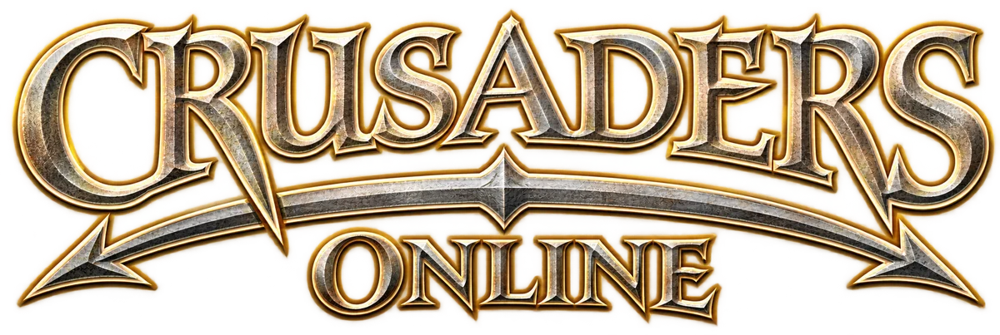
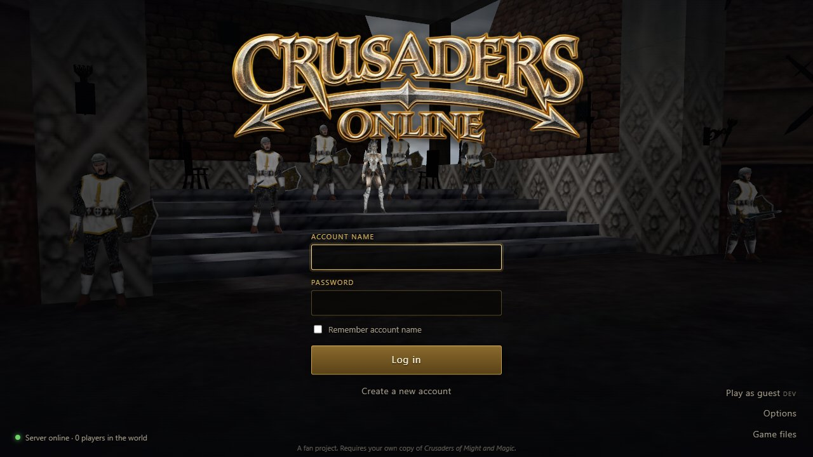
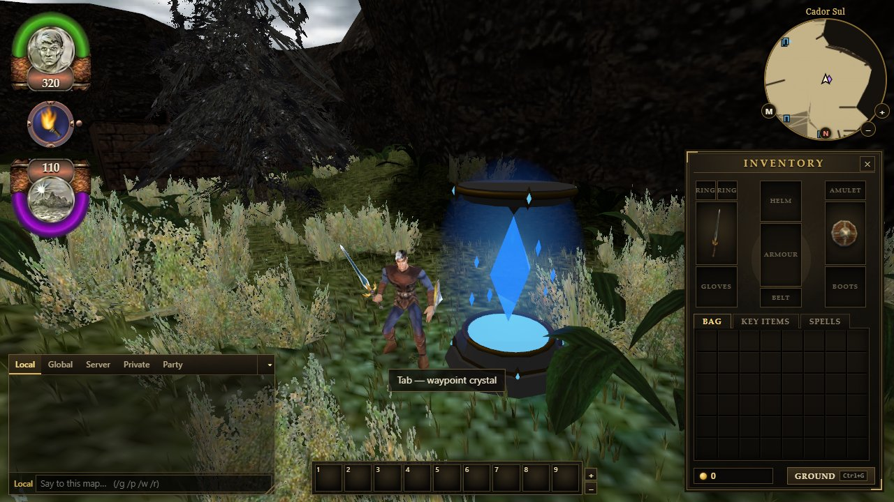
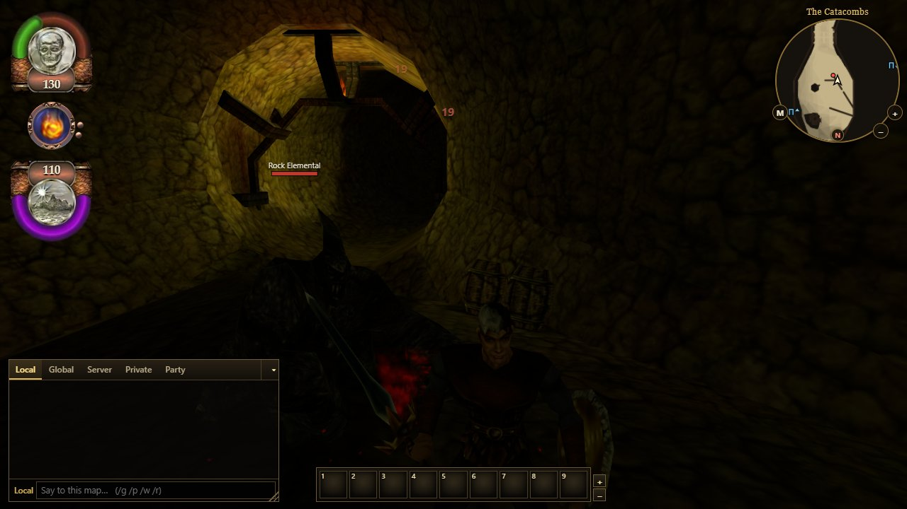
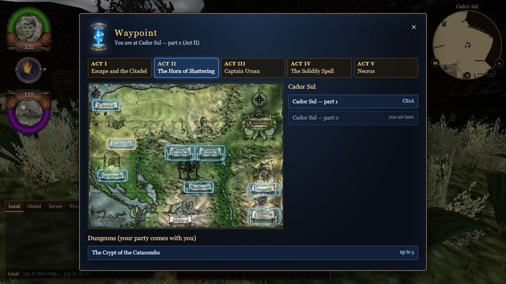

<p align="center"></p>

**Crusaders Online** is a fan-made, open-source remake of *Crusaders of Might and Magic* (3DO, 1999)
that runs in the browser as a persistent online RPG. It plays like the original (movement, camera,
combo combat, spells, story) on an authoritative multiplayer server, with optional MMO features
on top.

No original game files are in this repository. You load them from your own copy of the game
(for example the [GOG release](https://www.gog.com/)); they are converted in your browser and never
uploaded.

## Screenshots

| | |
|---|---|
|  |  |
|  |  |

<sub>Screenshots show the original game's art, loaded from a legally owned copy.</sub>

## Features

- 24 of the 25 original levels, with their lighting, doors, levers, portals and cutscenes
- The original movement, camera, five-hit combo, shield, all 11 spells and the creature AI
- Inventory, shops, potions, quest items and the main story
- Server-authoritative multiplayer: 20 Hz simulation, one worker per zone, client prediction
- Accounts and characters saved in PostgreSQL
- Chat, parties, trade and an auction house
- Optional MMO rules, each off by default (`GAME_FEATURES`): item rarity and affixes, instanced
  dungeons, crafting, area levels

## Running it locally

Requires Node.js 24+, pnpm and your own installation of *Crusaders of Might and Magic*.

```bash
pnpm install
cp .env.example .env
pnpm convert --input "./Crusaders of Might and Magic" --out "./local/generated"
pnpm dev:server
pnpm dev:client
```

Open <http://localhost:3000>. Development uses an embedded PostgreSQL (PGlite), so no database
server is needed. Skipping `pnpm convert` is fine too: the game asks for your install folder and
converts it in the browser.

Tests: `pnpm test:unit`, `pnpm test:integration`, `pnpm test:e2e`.

## Hosting a server

Docker Compose setup (Caddy with automatic TLS, PostgreSQL, backups, optional Cloudflare Tunnel)
is in [`deployment/`](deployment/); see [docs/deployment.md](docs/deployment.md).

## Project layout

| Folder | What's there |
|---|---|
| `client/` | Browser client (Three.js, TypeScript) |
| `server/` | Authoritative game server (Node.js) |
| `shared/` | Game rules, physics and network protocol used by both |
| `converter/` | Turns the original game files into web formats (CLI and in-browser) |
| `tests/` | Unit, integration, end-to-end and load tests |
| `docs/` | Design, reverse-engineering notes and per-change context notes |

## License

The code and documentation are licensed under the [GNU General Public License v3.0](LICENSE).
This covers only this repository's own work, not the original game's files, which stay with
their owners.

## Legal

This is an unofficial fan project, not affiliated with or endorsed by Ubisoft or the former 3DO
Company. *Crusaders of Might and Magic* and *Might and Magic* are trademarks of their owners and
are used here only to name the original game. See
[docs/asset-licensing-and-distribution.md](docs/asset-licensing-and-distribution.md).
