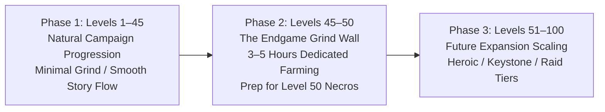

# Implementation Plan: Area Level Separation, XP Progression Curve & 11-Tier Affix Architecture

## Executive Architecture Summary

This plan outlines the end-to-end design and technical implementation for:
1. **Per-Area / Map Level Separation:** Explicit level zoning across all campaign acts (Acts 1–5), scaling resident monsters, and pinning **Necros at Level 50** as the campaign apex boss.
2. **Asymptotic XP Pacing (1–100):** Campaign progression naturally delivers the player to **Level 45** with minimal grinding; Levels **45–50** introduce an intentional endgame grind curve (3–5 hours of focused dungeon/elite farming) to prepare for Necros; mathematically structured to expand to **Level 100** max.
3. **11-Tier Affix System (T0–T10 / T11):** Current baseline affixes calibrated as **Tier 5** (middle tier). Equal linear division where Tier 5 rolls up to 50 Max HP and Tier 10 rolls up to 100 Max HP.
4. **Item Level (iLvl) Gating & Sliding Roll Windows:** Items roll affixes within a 4-tier sliding window $[\max(0, \text{bandTier} - 3), \text{bandTier}]$, guaranteeing iLvl 90–100 gear rolls between **Tier 7 minimum** and **Tier 10 maximum**.

---

## 1. Map & Area Level Separation Architecture

### 1.1 Act & Zone Level Distribution Table (Acts 1 to 5)

The game's 81 acts (`shared/src/game/waypoints.ts`) are partitioned into explicit level brackets corresponding to narrative chapters:

| Chapter | Acts / Map Codes | Regional Setting | Level Bracket | Primary Resident Mob Archetypes | Zone Combat Rules |
|:---:|---|---|:---:|---|---|
| **0** | `train` | Prison Tutorial | **1 – 2** | Skeletons (Novice) | Tutorial, no death penalty |
| **1** | `ws9a`, `ws1a` | Stronghold Escape | **2 – 4** | Skeleton Scouts, Outlaws | Open courtyards |
| **1** | `cs1b`, `cs1a` | Cador Sul Outskirts | **5 – 7** | Skeleton Warriors, Rogues | Plains, low-level gathering |
| **1** | `ci1a`, `ci1b`, `ci9a`, `ci9b` | Citadel Outer & Lower | **8 – 10** | Citadel Guards, Corrupted Skeletons | Citadel gates |
| **SAFE** | `ci1b` (Keep), `cs1b-inn` | Towns & Taverns | **SAFE** | None (Town NPCs & Merchants) | Sanctuary Zone: combat locked, +5%/s regen |
| **2** | `ci2a`–`ci2b`, `cs2a`–`cs2b`, `ws2a` | Horn Search: Outskirts | **11 – 14** | Skeleton Warriors, Dasher Brutes | Corridor battles |
| **2** | `ca1a`, `ca1b`, `ca1c`, `ca1d` | Catacombs: Upper Crypts | **15 – 19** | Skeleton Ghosts, Skeleton Archers | Crypt hallways, swinging bridges |
| **2** | `du1a`, `du1b`, `es1a` | Duskwood: Outer Forest | **20 – 23** | Dasher Brutes, Dire Wolves | Botanical gathering, ambush packs |
| **2** | `co1a`, `cm1a`–`cm2b`, `co2a` | Corantha Mines & Bastion | **24 – 28** | Dwarf Rebels, Zealots, Dark Mages | Tight subterranean tunnels |
| **2** | `du2a`–`du3b`, `es2a`–`es3a`, `co3a` | Duskwood Ogre Stronghold | **28 – 32** | Ogre Outlaws, Dark Masters | Heavy cleave damage, elite packs |
| **3** | `cs3a`–`ws3a`, `ca2a`–`ca2d` | Deep Catacombs Crypts | **33 – 36** | Bone Golems, Greater Shadows | Heavy bash checks, spellcasters |
| **3** | `gl2a`–`gl2b`, `gl1a`–`gl1b` | Glaciers: Ursan's Caverns | **36 – 40** | Ice Titans, Ice Elementals | Heavy frost checks, slows |
| **4** | `du1c`–`du9c`, `gl3a`–`gl4c` | High Glaciers & Spire | **40 – 42** | Frost Revenants, Rock Elementals | Freezing hazards, elite titans |
| **4** | `du2c`–`du4b`, `co4a`, `ci4a`–`ci4b`, `ca3a`–`ca3d` | High Bastion & Corantha Peak | **42 – 44** | Greater Black Knights, Deceivers | High magic burst, group pulls |
| **5** | `es4a`, `es4b`, `ws5a` | Eastern/Western Stronghold Core | **45 – 48** | Shadow Champions, Lava Elementals | Campaign endgame prelude |
| **5** | `bs1a` (Battleship Mobs) | Necros's Battleship Deck | **48 – 50** | Necros Elite Guards, Deceivers | Apex mob pack density |
| **5** | `bs1a` (Arena Encounter) | **Battleship Bridge / Core** | **50** | **Necros (Apex Campaign Boss)** | **Level 50 Boss (1000 HP, Dark 40, Knockdowns)** |
| **POST** | `cs5b` | Cador Sul Epilogue | **SAFE** | Citizens, Survivors | Victory hub, portal unlocks |

### 1.2 Monster Dynamic Level Scaling Formula

When a monster instance spawns in an act:
1. Base Area Level $L_{\text{area}}$ is fetched from `AREA_LEVELS[act]`.
2. Monster Level $L_m = L_{\text{area}} + \text{offset}$ (standard mob = 0, elite = +1, act mini-boss = +2, Necros = fixed 50).
3. Derived mob combat properties scale based on $L_m$:
   $$\text{MaxHP}(L_m) = \text{BaseHP} \times \left(1.0 + 0.045 \times (L_m - 1)\right)$$
   $$\text{WeaponDamage}(L_m) = \text{BaseDmg} \times \left(1.0 + 0.035 \times (L_m - 1)\right)$$
   $$\text{XPReward}(L_m) = \text{BaseXP}(L_m) \times \text{MobMultiplier}$$

---

## 2. XP Pacing & Progression Curve (Levels 1 to 100)

### 2.1 The Three Pacing Phases



### 2.2 Mathematical Formulations

#### 1. Experience Required to Reach Next Level: $XP_{\text{step}}(L)$
- **Levels 1 to 45 (Campaign Phase):**
  $$XP_{\text{step}}(L) = \left\lfloor 350 \times L^{1.32} + 150 \right\rfloor$$
  - Level 1 → 2: 500 XP
  - Level 10 → 11: 7,500 XP
  - Level 25 → 26: 25,000 XP
  - Level 44 → 45: 55,000 XP
  - *Cumulative XP at Level 45:* $\approx 850,000\text{ XP}$ (Matches ~25–35 hours of natural questing, act exploration, and story clears).

- **Levels 45 to 50 (The Necros Grind Wall):**
  A sharp step-up curve requiring concentrated effort:
  $$XP_{\text{step}}(L) = \left\lfloor XP_{\text{step}}(45) \times (1.55)^{L - 45} \right\rfloor$$
  - Level 45 → 46: 85,000 XP
  - Level 46 → 47: 132,000 XP
  - Level 47 → 48: 205,000 XP
  - Level 48 → 49: 318,000 XP
  - Level 49 → 50: 495,000 XP
  - *Cumulative XP from 45 to 50:* $\approx 1,235,000\text{ XP}$ (Greater than the entire 1–45 campaign combined! At ~250k XP/hr in high-density Act 5 areas / Corantha / Dungeons, this represents **4 to 5 hours of dedicated endgame grinding**).

- **Levels 51 to 100 (Future Maximum Expansion):**
  $$XP_{\text{step}}(L) = \left\lfloor 550,000 + 45,000 \times (L - 50) + 1,200 \times (L - 50)^2 \right\rfloor$$
  Provides a clean, asymptotic curve reaching $\approx 45,000,000\text{ cumulative XP}$ at Level 100.

#### 2. Monster Base XP Yield: $\text{BaseXP}(L_m)$
$$\text{BaseXP}(L_m) = \left\lfloor 18 \times L_m^{1.22} + 20 \right\rfloor$$
- Level 1 mob: 38 XP
- Level 10 mob: 320 XP
- Level 25 mob: 1,120 XP
- Level 45 mob: 2,450 XP
- Level 50 mob: 2,850 XP (Elites yield $2.5\times \approx 7,125\text{ XP}$; Dungeon Bosses yield $10\times \approx 28,500\text{ XP}$)

#### 3. Level Delta Scaling $\Delta L = L_{\text{player}} - L_{\text{mob}}$ (Diminishing Returns)
$$\text{XPFactor}(\Delta L) = \begin{cases}
1.0 & |\Delta L| \le 3 \text{ (Optimal band)} \\
\max\left(0.02, 1.0 - 0.15 \times (\Delta L - 3)\right) & \Delta L > 3 \text{ (Punching down, minimum 1 XP floor)} \\
\min\left(1.20, 1.0 + 0.05 \times (-\Delta L - 3)\right) & \Delta L < -3 \text{ (Punching up bonus)}
\end{cases}$$

---

## 3. 11-Tier Affix System (T0 to T10 / T11)

### 3.1 Design Principles
- **Tier 5 is the Middle Baseline:** The existing game values (`item_mods.ts`) represent Tier 5 affixes.
- **Equal Linear Division:** Tier 5 max is 50 HP $\implies$ Tier 10 max is **100 HP** (+10 HP per tier max).
- **11 Discrete Ranges:** Tiers 0 through 10 provide 11 equal progression bands.
- **Tier 11 (Pinnacle/Overcap):** Reserved for perfect iLvl 100 rolls, celestial crafting, or masterwork catalysts (+110 HP).

### 3.2 Master Affix Tier Matrix

#### 1. Hit Points (`hp`) — Rolls on Armor, Shields, Helm, Boots, Belt, Ring, Amulet
| Tier | Item Level Band | Roll Range | Description |
|:---:|:---:|:---:|---|
| **T0** | 0 – 9 | **+1 to +5 HP** | Novice / Starter scrap |
| **T1** | 10 – 19 | **+6 to +10 HP** | Cador Sul militia |
| **T2** | 20 – 29 | **+11 to +20 HP** | Catacombs veteran |
| **T3** | 30 – 39 | **+21 to +30 HP** | Duskwood ranger |
| **T4** | 40 – 49 | **+31 to +40 HP** | Glacial vanguard |
| **T5** | **50 – 59** | **+41 to +50 HP** | **Current Middle Baseline (Necros L50 drops)** |
| **T6** | 60 – 69 | **+51 to +60 HP** | Heroic tier 1 |
| **T7** | 70 – 79 | **+61 to +70 HP** | Heroic tier 2 |
| **T8** | 80 – 89 | **+71 to +80 HP** | Mythic / Keystone |
| **T9** | 90 – 99 | **+81 to +90 HP** | Apex endgame |
| **T10** | **100** | **+91 to +100 HP** | **Max Level Pinnacle (100 HP Target)** |
| *T11* | *100+ (Masterwork)* | *+101 to +110 HP* | *Pinnacle Overcap / Divine Catalyst* |

#### 2. Mana Pool (`mana`) — Rolls on Any Gear Slot
| Tier | Item Level Band | Roll Range | Description |
|:---:|:---:|:---:|---|
| **T0** | 0 – 9 | **+2 to +6 Mana** | Apprentice glimmer |
| **T1** | 10 – 19 | **+7 to +12 Mana** | Novice focus |
| **T2** | 20 – 29 | **+13 to +24 Mana** | Scholar insight |
| **T3** | 30 – 39 | **+25 to +36 Mana** | Mage attunement |
| **T4** | 40 – 49 | **+37 to +48 Mana** | Sorcerer reservoir |
| **T5** | **50 – 59** | **+49 to +60 Mana** | **Current Baseline (Max 60 Mana)** |
| **T6** | 60 – 69 | **+61 to +72 Mana** | High wizardry |
| **T7** | 70 – 79 | **+73 to +84 Mana** | Archmage conduit |
| **T8** | 80 – 89 | **+85 to +96 Mana** | Eldritch font |
| **T9** | 90 – 99 | **+97 to +108 Mana** | Astral spring |
| **T10** | **100** | **+109 to +120 Mana** | **Max Level Pinnacle (120 Mana Target)** |
| *T11* | *100+ (Masterwork)* | *+121 to +132 Mana* | *Divine Mana Core* |

#### 3. Flat Physical Damage (`dmg:SLASH` / `dmg:BASH`) — Rolls on Weapons
| Tier | Item Level Band | Roll Range | Description |
|:---:|:---:|:---:|---|
| **T0** | 0 – 9 | **+1 Damage** | Dull / Rusted |
| **T1** | 10 – 19 | **+2 Damage** | Serviceable |
| **T2** | 20 – 29 | **+3 to +4 Damage** | Sharpened / Weighted |
| **T3** | 30 – 39 | **+5 to +6 Damage** | Balanced / Heavy |
| **T4** | 40 – 49 | **+7 to +9 Damage** | Brutal / Serrated |
| **T5** | **50 – 59** | **+10 to +12 Damage** | **Current Baseline (Max 12 Damage)** |
| **T6** | 60 – 69 | **+13 to +15 Damage** | Masterwork blade |
| **T7** | 70 – 79 | **+16 to +18 Damage** | Executioner's edge |
| **T8** | 80 – 89 | **+19 to +21 Damage** | Destroyer's force |
| **T9** | 90 – 99 | **+22 to +24 Damage** | Mythic devastator |
| **T10** | **100** | **+25 to +27 Damage** | **Max Level Pinnacle (+27 Flat Damage)** |
| *T11* | *100+ (Masterwork)* | *+28 to +30 Damage* | *Pinnacle God-forged* |

#### 4. Elemental & Magic Resistances (`res:FIRE`, `res:AIR`, etc.) — Rolls on Armor & Accessories
*(Note: Subject to global character hard-cap of 75.0% resistance)*
| Tier | Item Level Band | Roll Range | Description |
|:---:|:---:|:---:|---|
| **T0** | 0 – 9 | **+1% to +2%** | Insulation trace |
| **T1** | 10 – 19 | **+3% to +4%** | Minor ward |
| **T2** | 20 – 29 | **+5% to +7%** | Elemental guard |
| **T3** | 30 – 39 | **+8% to +10%** | Hardened barrier |
| **T4** | 40 – 49 | **+11% to +14%** | Resistant bulwark |
| **T5** | **50 – 59** | **+15% to +18%** | **Current Baseline (Max 18% Resist)** |
| **T6** | 60 – 69 | **+19% to +22%** | Reinforced Aegis |
| **T7** | 70 – 79 | **+23% to +26%** | Mystic reflection |
| **T8** | 80 – 89 | **+27% to +30%** | Prismatic shield |
| **T9** | 90 – 99 | **+31% to +34%** | Invulnerable mantle |
| **T10** | **100** | **+35% to +38%** | **Max Level Pinnacle (Max 38% on single piece)** |
| *T11* | *100+ (Masterwork)* | *+39% to +42%* | *Divine Immunity Weave* |

#### 5. Core Attributes (`attr:might`, `attr:intellect`, `attr:endurance`, `attr:speed`) — Rolls on Any Slot
| Tier | Item Level Band | Roll Range | Description |
|:---:|:---:|:---:|---|
| **T0** | 0 – 9 | **+1 Stat** | Minor potency |
| **T1** | 10 – 19 | **+1 Stat** | Steady trait |
| **T2** | 20 – 29 | **+2 Stats** | Reinforced power |
| **T3** | 30 – 39 | **+3 Stats** | Seasoned prowess |
| **T4** | 40 – 49 | **+4 Stats** | Knightly excellence |
| **T5** | **50 – 59** | **+5 Stats** | **Current Baseline (Max +5 Stat)** |
| **T6** | 60 – 69 | **+6 Stats** | Champion's vigor |
| **T7** | 70 – 79 | **+7 Stats** | Heroic mastery |
| **T8** | 80 – 89 | **+8 Stats** | Titan's might |
| **T9** | 90 – 99 | **+9 Stats** | Demigod caliber |
| **T10** | **100** | **+10 Stats** | **Max Level Pinnacle (+10 Single Stat)** |
| *T11* | *100+ (Masterwork)* | *+11 to +12 Stats* | *Celestial Ascendance* |

---

## 4. Item Level (iLvl) Bands & Sliding Roll Window Algorithm

### 4.1 The Sliding Roll Window Rule
Every equipment item possesses an intrinsic `iLvl` (derived from monster level or zone chest level).
Affixes rolled on an item cannot exceed the item's maximum tier, and higher-level items have their lower tier garbage rolls pruned by an authoritative sliding floor:

$$\text{MaxTier}(iLvl) = \min(10, \lfloor iLvl / 10 \rfloor)$$
$$\text{MinTier}(iLvl) = \max(0, \text{MaxTier}(iLvl) - 3)$$

When an item rolls an affix, the server uniformly rolls a Tier $T \in [\text{MinTier}(iLvl), \text{MaxTier}(iLvl)]$, then rolls the value within that tier's $[min, max]$ bracket.

### 4.2 Complete Item Level Band Matrix
| iLvl Band | Corresponding Tier | Min Tier Roll | Max Tier Roll | Example HP Roll Window |
|---|:---:|:---:|:---:|---|
| **iLvl 0 – 9** | **T0** | **T0** | **T0** | +1 to +5 HP |
| **iLvl 10 – 19** | **T1** | **T0** | **T1** | +1 to +10 HP |
| **iLvl 20 – 29** | **T2** | **T0** | **T2** | +1 to +20 HP |
| **iLvl 30 – 39** | **T3** | **T0** | **T3** | +1 to +30 HP |
| **iLvl 40 – 49** | **T4** | **T1** | **T4** | +6 to +40 HP (T0 pruned!) |
| **iLvl 50 – 59** | **T5** | **T2** | **T5** | **+11 to +50 HP (Necros L50 drops)** |
| **iLvl 60 – 69** | **T6** | **T3** | **T6** | +21 to +60 HP |
| **iLvl 70 – 79** | **T7** | **T4** | **T7** | +31 to +70 HP |
| **iLvl 80 – 89** | **T8** | **T5** | **T8** | +41 to +80 HP |
| **iLvl 90 – 99** | **T9** | **T6** | **T9** | +51 to +90 HP |
| **iLvl 100** | **T10** | **T7** | **T10** | **+61 to +100 HP (Exact dj requirement: Min T7, Max T10)** |

---

## 5. Technical Implementation Steps

### Phase 1: Shared Core Types & Data Definitions
- **`shared/src/game/area_levels.ts`**:
  - Export `AREA_LEVELS: Readonly<Record<string, number>>` mapping all 81 acts to their level brackets.
  - Export `areaLevel(act: string): number`.
- **`shared/src/game/combat.ts`**:
  - Update `MAX_LEVEL = 100` (expandable cap).
  - Replace linear `xpForLevel(level: number)` with the new piecewise 1–45 / 45–50 / 51–100 progression curve.
  - Implement `xpRewardForKill(mobLevel: number, playerLevel: number, isBoss = false): number`.
- **`shared/src/game/items.ts`**:
  - Update `ItemAffix`: add `tier?: number` (0..10).
  - Update `ItemMods`: add `ilvl?: number` (1..100).
  - Update `sanitizeMods` to preserve `ilvl` and affix `tier`.
- **`shared/src/game/item_mods.ts`**:
  - Implement `AFFIX_TIERS` data structures containing the 11 tiers per family.
  - Implement `tierRollRange(family: string, tier: number): { min: number; max: number }`.
  - Update `rollMods(def: ItemDef, random: () => number, ilvl = 50): ItemMods`.
  - Update `affixRange(id: string, tier?: number): { min: number; max: number }`.
  - Update `affixLines` to format `+45 Hit points (T5: 41–50)`.

### Phase 2: Server Zone Simulation & Monster Scaling
- **`server/src/simulation/world_zone.ts`**:
  - In `spawnMob`:
    - Lookup act level from `areaLevel(this.arena.name.replace(/^level:/, ''))`.
    - If `archetypeId === 'necros'`, enforce `mob.level = 50`.
    - Scale `mob.maxHp`, `mob.hp`, and attack damage by `mob.level`.
  - In `grantReward` / `dropKillLoot`:
    - Pass `mob.level` (or `areaLevel`) as the dropped gear's `ilvl`.
    - `rollMods(def, this.random, mob.level)`.
  - In `addExperience`:
    - Process new level milestones up to 50 (and future 100).
- **`shared/src/protocol/control/server.ts`**:
  - Add `level?: number` to `EntitySpawnMsg['d']`.

### Phase 3: Client HUD, Tooltips & Visual Feedback
- **`client/src/ui/inventory_panels.ts`**:
  - Render `Item Level: ${item.mods.ilvl}` in the header of item tooltips.
  - Render affix tier tags: `<span class="tt-tier">T${a.tier}</span>`.
- **`client/src/ui/combat_ui.ts`**:
  - Update floating combat healthbars:
    ```typescript
    const lvlText = e.info.level ? `[Lv.${e.info.level}] ` : '';
    (bar.querySelector('.name') as HTMLElement).textContent = `${lvlText}${e.info.name}`;
    ```
  - Colorize monster level based on delta relative to player level (gray / green / yellow / orange / red skull).

### Phase 4: Unit Testing & Verification
- **`tests/unit/area_levels.test.ts`**:
  - Verify every campaign act has a defined level bracket.
  - Verify Necros is pinned at Level 50.
- **`tests/unit/item_mods.test.ts`**:
  - Verify all 11 tiers (T0–T10) across all 5 affix families.
  - Test iLvl 90–100 items roll strictly between Tier 7 and Tier 10 over 5,000 simulated drops.
  - Test Tier 5 HP rolls max 50; Tier 10 HP rolls max 100.
  - Verify `withoutAffixes` round-trips correctly with tier metadata.
- **`tests/unit/combat.test.ts`**:
  - Test XP curve thresholds at levels 45, 50, and 100.
  - Verify asymptotic diminishing returns for lower-level kills.

---

## 6. Verification Checklist
- [ ] `pnpm test:unit` passes across all test suites without regressions.
- [ ] Starting in `train` spawns Level 1 mobs; arriving at `bs1a` spawns Level 50 Necros.
- [ ] Slaying Necros or Act 5 mobs drops iLvl 50 gear rolling T2..T5 affixes (Max 50 HP).
- [ ] Crafting or acquiring iLvl 100 gear rolls T7..T10 affixes (Max 100 HP, Min T7).
- [ ] Player leveling pacing from 1 to 45 completes during natural story playthrough; 45 to 50 requires several hours of high-level mob farming.
