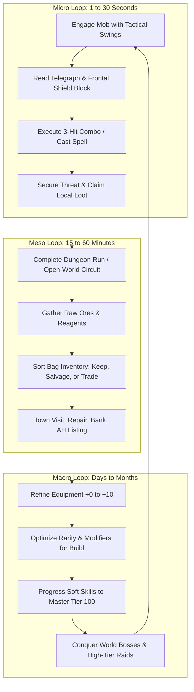

# 01 — MMO Design Pillars & Core Experience

## 1. Executive Summary & Vision

*Crusaders of Might and Magic* was released in 1999 as a single-player, third-person action-RPG characterized by deliberate melee timing, directional shield blocks, stamina-driven locomotion, and dark fantasy dungeon exploration. 

**Crusaders of Might and Magic Online** transforms this foundation into a persistent browser-based MMORPG. The design mission is not to overlay networking onto a single-player game, but to architect a living, competitive, and cooperative multiplayer ecosystem that retains the tactical weight, aesthetic grit, and atmospheric tension of the 1999 classic while solving the systemic pitfalls of modern MMORPGs (runaway inflation, botting, multi-boxing, AFK exploitation, and toxic kill-stealing).

---

## 2. The Core MMO Experience Loop

The player journey operates on three interconnected time scales:

### 2.1 Micro Loop (Second-to-Second Combat)
- **Deliberate Animation Commitment:** Melee attacks commit the player to discrete startup (150 ms), active (150 ms), and recovery (250 ms) windows. Spamming inputs does not accelerate DPS.
- **Directional Defense:** Shield blocks require active stamina management and facing the attacker within a $\approx \pm 81^\circ$ frontal cone ($\cos(30^\circ)$ threshold). Hits cannot be absorbed passively from all angles.
- **Spatial Positioning:** Hit detection uses forward sweeps ($110^\circ$ arc, $2.2\text{ m}$ reach). Proper flanking, spacing, and projectile evasion dictate survival.

### 2.2 Meso Loop (Session-to-Session Gameplay)
- **Expedition Planning:** Venturing into hostile zones (e.g., Catacombs, Stronghold) requires bag management (8×6 grid, 48 cells), consumable preparation (healing elixirs, mana crystals), and equipment durability monitoring.
- **Resource Extraction:** Harvesting dynamic mineral veins and botanical nodes while clearing territorial monster spawns.
- **Economic Liquidation:** Returning to sanctuary towns to trade with other players, craft reagents, list items on the Centralized Auction House, and upgrade gear.

### 2.3 Macro Loop (Long-Term Progression)
- **Vertical Gear Refinement:** Pushing gear from $+0$ to $+10$ across 3 material tiers, accumulating failstack pity bonuses without risking item destruction or level loss.
- **Horizontal Build Customization:** Accumulating rare equipment with complementary affix pools (e.g., Slash Damage, Speed Multiplier, Spell Crit) and leveling soft skills (Mining, Smithing, Alchemy) to craft endgame enhancements.
- **Group Mastery:** Organizing party raids against open-world behemoths and instanced multi-phase dungeon encounters.

---

## 3. Single-Player Foundations vs. MMO Adaptations

| Feature / System | Original Single-Player Game (1999) | CrusadersOnline MMORPG Adaptation | Rationale & Design Trade-off |
|---|---|---|---|
| **World State** | Static level geometry; monsters placed once; state reset on reload. | Persistent shared world zones with 20 Hz simulation; dynamic respawn pools. | Accommodates hundreds of concurrent players competing for encounters without map exhaustion. |
| **Monster Combat** | One player vs. 1–3 enemies. Mob focuses exclusively on Drake. | Threat-table aggro (Damage + Healing). Shared combat participation. | Enables tanking, healing, and group coordination; prevents single-target griefing. |
| **Loot Allocation** | Fixed placement in level; chests looted once; monsters drop specific items. | Server-authoritative instanced drop rolls based on contribution thresholds. | Eliminates kill-stealing, ninja looting, and monopolization by high-burst veterans. |
| **Pacing & Power** | Drake scales rapidly; high-end weapons double damage; single playthrough. | Controlled logarithmic scaling; attribute caps (50); stat diminishing returns. | Prevents exponential power creep from invalidating early-game zones and content. |
| **Item Economy** | Infinite NPC merchant gold; items sold at full price; no trade. | Closed player-driven economy; gold faucets balanced by repair, listing, and refinement sinks. | Prevents runaway hyperinflation; establishes organic value for crafted and discovered goods. |
| **Death Consequence** | Game Over screen; reload last manual save slot. | Respawn at zone anchor with 5% durability damage and temporary death sickness debuff. | Provides meaningful death penalty without frustrating progress loss or corpse camping. |
| **Movement & Camera** | Direct third-person chase camera; tank-like turning; root motion jumps. | Free camera orbit; responsive WASD + mouse aim; server-authoritative Rapier3D physics. | Necessary for modern browser responsiveness and low-latency network prediction. |

---

## 4. Key Design Constraints & Non-Goals

### 4.1 Technical & Environmental Constraints
1. **Zero Client Trust:** All combat hits, damage calculations, cooldowns, loot drops, and inventory changes are adjudicated solely by the server zone worker. The client is strictly an input-forwarding and state-rendering terminal.
2. **Web Browser Performance Budget:** Memory footprints must remain under $500\text{ MB}$; Three.js render loops must maintain 60 FPS on mid-range hardware without demanding discrete GPUs. Shaders and particle emitters must be aggressively pooled and LOD-managed.
3. **Network Latency Variance:** The game must function gracefully across latency ranges of $20\text{ ms}$ to $180\text{ ms}$ using client-side prediction, input buffering, and server-side lag compensation.

### 4.2 Non-Goals (Explicitly Out of Scope)
- **No Full-Loot Open PvP:** Open-world griefing and unrestricted inventory dropping upon player kill destroys casual retention and breeds toxicity. Any future PvP will be restricted to designated arenas or consensual guild warfare.
- **No Pay-to-Win Monetization:** No microtransactions that sell raw stats, upgrade success boosts, or exclusive combat gear. Revenue must rely entirely on cosmetic items, character slots, or convenience storage.
- **No Mandatory Daily Chore Systems:** No mobile-style "energy meters" or punitive daily login streak mechanics. Content should be naturally engaging, not psychologically coercive.
- **No Tab-Target Auto-Attack:** Combat remains physically simulated and action-oriented. Players must actively aim weapon swings and line up spell trajectories.

---

## 5. Architectural Alignment with Repository Findings

The MMO design directly incorporates verified engine architecture and historical data recovered in `docs/`:

- **Attribute Framework:** The 4 original attributes—Might ($M$), Intellect ($I$), Endurance ($E$), and Speed ($S$)—are capped at 50, strictly following `shared/src/game/original_stats.ts`.
- **Damage Vector System:** All physical, elemental, and magical combat operations utilize the verified 11-element damage vector: `SLASH`, `BASH`, `FIRE`, `AIR`, `EARTH`, `WATER`, `MIND`, `SPIRIT`, `BODY`, `LIGHT`, and `DARK` (`ruleset.ts`).
- **Inventory Topology:** Implements the 8×6 grid (48 slots) plus worn equipment layout inspired by MU Online, matching `docs/context/2026-10-16-inventory-mu-window-and-authority.md`.
- **Simulation Loop:** Designed around the 20 Hz server zone worker model and Kysely PostgreSQL persistence engine documented in `docs/mmorpg-architecture.md`.
