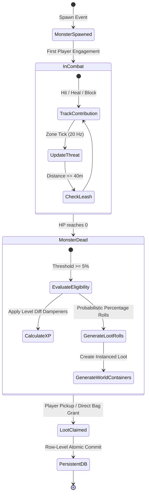

# 02 — Shared Monster Combat & Loot Distribution Specification

## 1. The Core Multiplayer Dilemma

In the original single-player *Crusaders of Might and Magic*, an enemy exists solely for Drake. When killed, fixed drops spawn at the entity's coordinates, or predefined items are awarded directly into inventory.

In a persistent MMORPG, dozens of players may occupy the same dungeon corridor or clearing. This introduces immediate failure modes:
1. **Kill Stealing (KS):** A high-level player strikes an enemy once with a late burst hit, claiming all rewards while the player who fought for 30 seconds receives nothing.
2. **Tagging & Leeching:** A player taps an enemy for 1 point of damage and stands idle while another player finishes the encounter.
3. **Passive AFK Proximity Farming:** A player parks their character (or secondary multi-box accounts) near a high-traffic monster spawn point and collects gold and XP passively.
4. **Burst / One-Shot Denial:** A geared veteran one-shots low-level monsters, completely locking out new players trying to complete quests or progress.

This document establishes a mathematically rigorous, server-authoritative loot and reward distribution architecture designed to solve these issues permanently.

---

## 2. Evaluation of Candidate Loot Architectures

| Model | Mechanics | Advantages | Severe Exploits & Weaknesses | Verdict |
|---|---|---|---|---|
| **1. First-Hit Ownership** | First player to inflict $\ge 1$ damage owns 100% of the loot rights. | Simple to explain; clear immediate feedback. | Ranged players tag everything instantly; griefers tag mobs and abandon them; encourages speed-tag botting. | **Rejected** |
| **2. Highest-Damage Ownership** | 100% of loot goes to whichever entity dealt the highest raw damage. | Rewards high DPS and optimal gear builds. | Total disenfranchisement of support/tanks; high-level players steal any mob at will. | **Rejected** |
| **3. Shared Public Loot** | All items drop as physical world containers on the ground, open to all. | Social nostalgia; high chaos. | Script bots pick up loot instantly (0 ms reaction); promotes toxic friction and ninja looting. | **Rejected** |
| **4. Strict Party-Only Loot** | Loot is only shared if players form an explicit party beforehand. | Fosters pre-planned group coordination. | Hostile to organic open-world encounters; solo players cannot cooperate dynamically. | **Incomplete** |
| **5. Pure Proximity Loot** | Any player within $X$ meters when the mob dies gets full loot rolls. | Highly accessible; promotes casual grouping. | Triggers massive multi-boxing and AFK bot swarms parked at spawn nodes. | **Dangerous / Rejected** |
| **6. Hybrid Individual Instanced Loot** | Each eligible participant receives an independent server-side loot roll based on normalized contribution thresholds. | Eliminates kill stealing; fair to supports and low-levels; zero ninja looting. | Higher database write load; requires complex contribution tracking state on the server. | **RECOMMENDED PRIMARY** |

---

## 3. Recommended Architecture: Hybrid Individual Instanced Loot

### 3.1 Principles of the Hybrid Model
1. **Instanced Visibility:** Drops are rolled per-player and visible exclusively to that player. There is no physical competition to click on items.
2. **Dual-Tier Currency & Item Roll:**
   - **XP and Gold:** Scaled continuously based on contribution percentage, subject to level-scaling dampeners.
   - **Item Rolls:** Binary qualification based on exceeding a **Minimum Meaningful Contribution Threshold** ($T_{\text{min}} = 5\%$). All qualifying players receive an independent roll against the monster's loot table.
3. **Multi-Vector Contribution Metric:** Contribution is not merely damage dealt; it accounts for threat generated, damage absorbed (tanking), and active healing provided to engaged combatants.

### 3.2 Contribution Scoring Formulation

For each player $p$ engaged in combat against monster $m$, the server tracks a continuous contribution score $C(p, m)$:

$$C(p, m) = W_{\text{dmg}} \cdot D_{\text{dealt}}(p, m) + W_{\text{tank}} \cdot D_{\text{absorbed}}(p, m) + W_{\text{heal}} \cdot H_{\text{effective}}(p, m) + W_{\text{cc}} \cdot T_{\text{cc}}(p, m)$$

Where:
- $D_{\text{dealt}}(p, m)$: Raw damage inflicted by player $p$ onto monster $m$. Weight $W_{\text{dmg}} = 1.0$.
- $D_{\text{absorbed}}(p, m)$: Incoming damage from monster $m$ mitigated via shield block or armor absorption by player $p$. Weight $W_{\text{tank}} = 0.8$.
- $H_{\text{effective}}(p, m)$: Direct healing applied to players who are actively on monster $m$'s threat table (overhealing discarded). Weight $W_{\text{heal}} = 0.6$.
- $T_{\text{cc}}(p, m)$: Duration (seconds) of hard crowd-control applied to monster $m$ (freeze, stun, stagger). Weight $W_{\text{cc}} = 2.0$.

The **Total Combat Energy** $E(m)$ is the sum of all participant scores:
$$E(m) = \sum_{i \in \text{Participants}} C(p_i, m)$$

The normalized participation ratio $\Phi(p, m)$ is:
$$\Phi(p, m) = \frac{C(p, m)}{E(m)}$$

---

## 4. Probabilistic Drops & Fixed World Pickups

### 4.1 Elimination of Guaranteed 100% Mob Drops
In the original 1999 game, certain scripted encounters or unique enemies always dropped a fixed weapon (for example, the Ogre Brute dropping the *Thunderous Hammer*). 

In CrusadersOnline:
- **No Guaranteed 100% Item Drops:** To prevent high-tier items from flooding the economy through repetitive farming, **no named or rare item has a $100\%$ drop rate**.
- **Calibrated Drop Percentages:** Iconic named items are rolled probabilistically against the monster's loot table:
  - Common Monster Drops: $15\% \dots 25\%$ (e.g. Iron Scrap, Healing Potion).
  - Uncommmon Equipment: $5\% \dots 10\%$ (e.g. Long Sword, Scale Armor).
  - Named / Iconic Weapons (e.g., *Thunderous Hammer*, *Sword of the Crusader*): **$2.5\% \dots 4.0\%$** on qualifying boss kills.
- Every eligible participant with $\Phi(p, m) \ge 5\%$ gets an **independent roll** against this probability.

### 4.2 Dynamic Rarity on Fixed World Pickups & Level Chests
In CrusadersOnline, ground items and level chests placed in original act data (`.cap` object types 0x35 and 0x38) are instanced per-character (a character takes each once, tracked by `story_flags` `<level>-took:<id>`):
1. **Dynamic Rarity Roll on Claim:** When a character interacts with a world pickup (e.g., picking up an Axe in Cador Sul, or opening a hidden chest in the Catacombs), the item is **not** restricted to base Battle-worn.
2. **Cumulative CDF Roll:** The server executes the standard item rarity roll:
   - **Battle-worn ($70.0\%$):** Base original stats.
   - **Mundane ($25.0\%$):** $1.2\times$ base stats + 2 random affixes.
   - **Tempered ($4.9\%$):** $1.5\times$ base stats + 4 random affixes.
   - **Legendary ($0.1\%$):** $2.0\times$ base stats + 4 affixes + spell level bonus.
3. **Exploration Incentive:** This transforms every forgotten corner, hidden room, and dungeon alcove into an exciting loot opportunity for every player.

---

## 5. The Low-Damage Contention Problem

### 5.1 Problem Definition
Consider a Level 10 player fighting a Level 12 Skeleton Warrior ($300\text{ HP}$). A Level 50 player passes by and strikes the skeleton for $2,500\text{ damage}$ in a single hit. 

Under an unnormalized raw damage system, the Level 10 player would receive $0\text{ XP}$ and no loot.

### 5.2 Solution: Normalized Effort, Zero Farming Penalties & Fair Instanced Drops
In CrusadersOnline, **a player is never punished or denied loot for defeating weaker monsters**. Farming crafting components, basic refinement ores, and world drops from lower-level areas is a crucial and intended dimension of the game economy.

The system reconciles farming freedom with fair co-op distribution through three rules:

1. **Unpenalized Item Farming:** High-level players receive normal, unpenalized drop chances on all monsters regardless of level difference. An end-game player farming Level 10 Skeletons for Iron Scrap or rare cosmetics receives full normal loot rolls.
2. **Low-Level Contention Protection:** If a lower-level player inflicted $\ge 5\%$ of the monster's $\text{HP}_{\text{max}}$ before a higher-level player intervened, the lower-level player is guaranteed **100% full independent instanced loot rights** and unreduced level-appropriate XP.
3. **Dual Independent Reward Generation:** Overkill damage is suppressed in the score denominator ($\min(D_{\text{hit}}, \text{HP}_{\text{remaining}})$). If both players qualify ($\ge 5\%$), **both players receive independent instanced loot rolls**. The high-level player's participation does not invalidate the low-level player's drop.

### 5.3 Asymptotic XP Scaling (Extreme Difficulty, Mathematically Possible)
Players are not hard-blocked from gaining XP on low-level monsters. Instead, XP scales down via an asymptotic power curve with a **hard minimum floor of $1\text{ XP}$ per kill**:

$$\text{XP}_{\text{awarded}} = \max\left(1, \left\lfloor \text{BaseXP}(L_m) \times \left( \frac{L_m}{L_p} \right)^{2.2} \times \Phi(p, m) \right\rfloor \right)$$

- **Level 1 Mob vs. Level 1 Player:** Grants $5\text{ XP}$ ($100\%$).
- **Level 1 Mob vs. Level 20 Player:** Yields $\max(1, \lfloor 5 \times (1/20)^{2.2} \rfloor) = \mathbf{1 \text{ XP}}$.
- **Level 1 Mob vs. Level 49 Player:** Yields $\mathbf{1 \text{ XP}}$.
- Because reaching Level 50 requires $\approx 2,450,000\text{ cumulative XP}$, reaching the cap solely by slaying Level 1 skeletons requires **hundreds of thousands of kills**. It is monumentally arduous, but strictly and mathematically possible if a player commits to it.

---

## 6. Party vs. Solo Coexistence

When players form a party (up to 5 members):
1. **Aggregated Party Score:** The contribution scores of all party members within $30\text{ meters}$ of the monster are summed into a single party score $C_{\text{party}}(m) = \sum_{p \in \text{Party}} C(p, m)$.
2. **Threshold Qualification:** If $\Phi_{\text{party}}(m) \ge 5\%$, **all** party members within range qualify for individual reward rolls. This directly incentivizes dedicated tanks and healers who deal minimal damage.
3. **Party XP Sharing Formula:**
   $$\text{XP}_{\text{shared}} = \text{BaseXP} \times \left(1 + 0.10 \times (\text{PartySize} - 1)\right) \times \Phi_{\text{party}}(m)$$
   $$\text{XP}_{\text{member}} = \frac{\text{XP}_{\text{shared}}}{\text{PartySize}}$$

---

## 7. Anti-AFK, Anti-Bot & Multi-Boxing Mitigations

To prevent automated bot scripts and secondary idle accounts from farming rewards:
1. **Active Input Verification Window:** A character must have submitted an authoritative combat input (attack swing, block, spell cast, or active movement) within the last $12.0\text{ seconds}$ preceding the monster's death. Passive standing defaults contribution score to zero.
2. **Line-of-Sight & Obstacle Check:** Using Rapier3D raycasting, the zone worker verifies that the player had an unobstructed line-of-sight to the monster at the moment of death. Exploiting geometry to leech through walls is strictly rejected.
3. **Spatial Leash Boundary:** If a player moves more than $40.0\text{ meters}$ away from the encounter coordinates before death, their contribution state is immediately purged.
4. **Proximity-Only Penalty:** A player who is simply in proximity ($< 15\text{ m}$) but contributes $< 5\%$ receives **zero** gold, **zero** items, and **zero** XP. Proximity alone confers zero rights.

---

## 8. The Complete Reward Lifecycle

