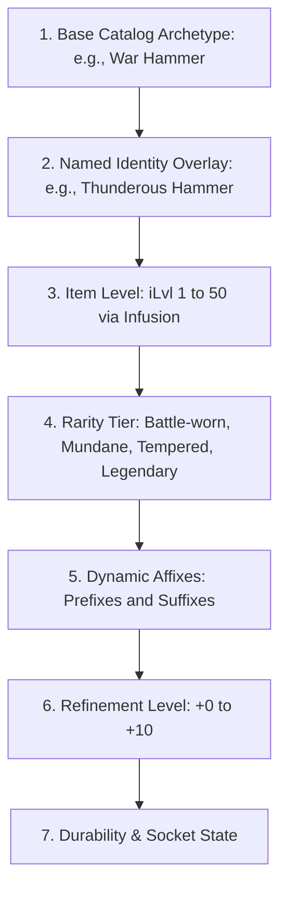

# 03 — Item Rarity, Affixes & Modifier Architecture

## 1. Item Rarity Tiers & Initial Concept Evaluation

In *Crusaders of Might and Magic*, items have fixed parameters defined in `items.ctx` (e.g., Long Sword deals 10 Slash damage; Banded Armor grants 0.8 protection). 

To support deep item hunting, horizontal build variety, and a thriving player economy, CrusadersOnline implements a 4-tier rarity system overlaid onto the authentic weapon, shield, and armor catalog:

| Rarity Tier | Display Color | Proposed Probability | Stat Multiplier | Random Affixes | Special Spell Bonus |
|---|---|---:|---|---|---|
| **Battle-worn** | Grey (`#9E9E9E`) | $70.0\%$ | $1.0\times$ (Original Base) | 0 affixes | None |
| **Mundane** | Blue (`#2196F3`) | $25.0\%$ | $1.2\times$ Base Stats | 2 random affixes | None |
| **Tempered** | Purple (`#9C27B0`) | $4.9\%$ | $1.5\times$ Base Stats | 4 random affixes | $+0$ to $+1$ Spell Skill Level |
| **Legendary** | Orange (`#FF9800`) | $0.1\%$ | $2.0\times$ Base Stats | 3 curated + 1 legendary affix | $+1$ to $+3$ Spell Skill Levels |

---

## 2. Rarity Probabilities & Cascading Roll Mathematics

### 2.1 The Probability Trap of Cascading Rolls
A common systems design error in RPG loot tables is configuring cascading conditional checks (roll Legendary first, then Tempered, then Mundane) using nominal percentage values without adjusting for conditional probability.

Chaining independent percentile checks without a cumulative distribution function (CDF) skews intended baseline yields across millions of drops.

### 2.2 Recommended Algorithm: Cumulative Threshold Distribution (CDF)
The server evaluates rarity using a single uniform random variable $U \sim \text{Uniform}[0.0, 1.0)$ mapped against cumulative threshold cutoffs:

$$\text{Thresholds: } \begin{cases}
T_{\text{Legendary}} = 0.001 & (0.1\%) \\
T_{\text{Tempered}} = 0.001 + 0.049 = 0.050 & (4.9\% \text{ delta}) \\
T_{\text{Mundane}} = 0.050 + 0.250 = 0.300 & (25.0\% \text{ delta}) \\
T_{\text{Battle-worn}} = 1.000 & (70.0\% \text{ remainder})
\end{cases}$$

```typescript
export type ItemRarity = 'battle_worn' | 'mundane' | 'tempered' | 'legendary';

export function rollItemRarity(luckModifier = 1.0): ItemRarity {
  const pLegendary = 0.001 * luckModifier;
  const pTempered = 0.049 * luckModifier;
  const pMundane = 0.250 * luckModifier;

  const roll = Math.random();

  if (roll < pLegendary) return 'legendary';
  if (roll < pLegendary + pTempered) return 'tempered';
  if (roll < pLegendary + pTempered + pMundane) return 'mundane';
  return 'battle_worn';
}
```

---

## 3. Named Items & Fixed Map Spawns

### 3.1 Named Items: Probabilistic Drop Rates (No Guaranteed 100% Drops)
In the original game, defeating certain elite enemies guaranteed a fixed weapon drop (e.g. Ogre Brute dropping the *Thunderous Hammer*). 
- **The MMO Rule:** In CrusadersOnline, **no high-tier named item has a 100% fixed drop rate**.
- Named items are rolled as calibrated drop percentages on the boss's loot table (e.g., *Thunderous Hammer* has a $3.5\%$ drop rate).
- When a named item drops, it retains its iconic unique perk (e.g., passive chain lightning or ground slam) and lore tooltip, while rolling its rarity tier and random affixes normally.

### 3.2 Fixed World Pickups & Level Chests: Dynamic Rarity Roll
In the original game, level items (ground pickups) and chests have fixed coordinates and static stats.
- **The Exploration Rule:** When a player character claims an instanced ground pickup or level chest, the item is **not** forced to be plain Battle-worn.
- The item executes the standard CDF rarity roll upon claim:
  - $70.0\%$ Battle-worn (original stats)
  - $25.0\%$ Mundane (1.2× stats + 2 affixes)
  - $4.9\%$ Tempered (1.5× stats + 4 affixes)
  - $0.1\%$ Legendary (2.0× stats + 4 affixes + spell bonus)
- This ensures exploration remains thrilling for all characters throughout the game's lifespan.

### 3.3 Unified Equipment Identity Hierarchy
To prevent contradictory states, an item's runtime state is composed of 7 orthogonal layers:



1. **Base Catalog ID:** Points to `BUILTIN_ITEMS` or `rules/items.json` (`id`, model, dimensions, base damage vector).
2. **Named Identity (Optional):** If present, defines an immutable unique passive perk (e.g. passive chain lightning) and custom tooltip lore.
3. **Item Level (iLvl 1 to 50):** 
   - Items drop with an initial `iLvl` matching the level range of the monster or zone (e.g., *Thunderous Hammer* dropping from a Level 28 Ogre Brute drops at **iLvl 28**).
   - An item's base damage and protection scale linearly with its iLvl: $\text{BaseStat}(iLvl) = \text{BaseStat} \times (1.0 + 0.02 \times (iLvl - 1))$.
   - **Item Level Infusion:** Players can elevate an item's iLvl step-by-step ($+1\text{ level}$ at a time) at a Blacksmith's Anvil up to their **current character level** using gold and soft-skill reagents (ingots, alchemical flux).
4. **Rarity Multiplier Application:** Multiplies the iLvl-scaled base physical damage and armor protection (Battle-worn $1.0\times$, Mundane $1.2\times$, Tempered $1.5\times$, Legendary $2.0\times$).
5. **Dynamic Affixes:** Randomly rolled prefixes and suffixes scaled to the item's current iLvl.
6. **Refinement Level (+0 to +10):** Multiplicative upgrade power ($+4\%$ to $+50\%$) with failstack pity protection.
7. **Durability & State:** Operational wear and binding status (*Unbound*, *BoE*, *BoP*).

---

## 4. Affix Taxonomy & Modifier Pools

Equipment modifiers are split into **Prefixes** (primarily offensive and physical attributes) and **Suffixes** (utility, resistances, and secondary effects).

### 4.1 Flat Increases
| Affix ID | Slot | Stat Modified | Roll Range (at iLvl 50) | Weight |
|---|---|---|---|---|
| `of_the_bear` | Suffix | Max HP | $+10 \text{ to } +50 \text{ HP}$ | 100 |
| `of_the_owl` | Suffix | Max Mana | $+15 \text{ to } +60 \text{ Mana}$ | 100 |
| `sharp` / `brutal` | Prefix | Flat Physical Damage | $+2 \text{ to } +12 \text{ Damage}$ | 80 |
| `of_the_crusader` | Suffix | Might / Endurance | $+1 \text{ to } +5 \text{ Stat}$ | 60 |

### 4.2 Resistances (Mapped to 11 Damage Types)
- **Physical Resistance:** Modifies both `SLASH` and `BASH` ($+2\% \text{ to } +15\%$).
- **Elemental Resistance:** Modifies `FIRE`, `AIR`, `EARTH`, and `WATER` ($+3\% \text{ to } +18\%$).
- **Magical Resistance:** Modifies `LIGHT` and `DARK` ($+3\% \text{ to } +18\%$).
- **Cosmic Resistance (Rare):** Modifies `MIND`, `SPIRIT`, and `BODY` ($+2\% \text{ to } +12\%$).

> **CRITICAL HARD CAP:** A character's total resistance to any damage type from all equipment, buffs, and passives cannot exceed **$75.0\%$** under any circumstance. Immune builds ($100\%$ resistance) are strictly prohibited.

### 4.3 Combat Property Affixes
| Affix ID | Affected Property | Roll Range | Technical Implementation in Engine |
|---|---|---|---|
| `quick_swing` | Swing Speed | $+3\% \text{ to } +15\%$ | Scales `weapon.speed` multiplier ($1.0 + 1.5 \times (\text{Speed} - 1)$), shortening swing animation ticks. |
| `fast_casting` | Cast Speed | $+4\% \text{ to } +20\%$ | Reduces wind-up and spell clip playback duration; triggers `SPELL` event earlier. |
| `heavy_impact` | Bash Damage Bonus | $+5\% \text{ to } +22\%$ | Multiplies the `BASH` component of outgoing weapon hits. |
| `keen_edge` | Slash Damage Bonus | $+5\% \text{ to } +22\%$ | Multiplies the `SLASH` component of outgoing weapon hits. |

### 4.4 Legendary & Exotic Modifiers (Tempered & Legendary Only)
| Affix ID | Mechanics & Roll Range | Balance Constraints |
|---|---|---|
| `lifesteal_melee` | Grants $+1 \text{ to } +4 \text{ HP}$ per landed melee swing. | Has a $400\text{ ms}$ internal cooldown per trigger to prevent spin-to-win AoE rapid healing. |
| `manasteal_melee` | Grants $+1 \text{ to } +3 \text{ Mana}$ per landed melee swing. | Capped at once per swing regardless of number of targets struck in the forward cone. |
| `deadly_strike` | $+2\% \text{ to } +8\%$ chance to deal $2.0\times$ critical damage. | Roll executed on server before armor calculation. |
| `archmage_focus` | $-5\% \text{ to } -18\%$ Mana Cost for all spells. | Additive with other cost reduction gear; hard floor at minimum 1 Mana cost. |

---

## 5. Modifier Stacking & Mathematical Balance Analysis (+10 Refinement)

### 5.1 Standardized Calculation Pipeline
CrusadersOnline enforces a strict **Base $\times$ Refinement $+$ Flat, followed by Additive Percentage Sums** pipeline:

$$\text{Final Damage} = \left[ \text{Base} \times M_{\text{rarity}} \times (1 + B_{\text{upgrade}}) + \sum D_{\text{flat}} \right] \times \left[ 1 + \sum P_{\text{percentile}} \right]$$

Applying this formula to a **Legendary Broad Sword at $+10$**:
- Base: $10 \text{ Slash}$
- Legendary Multiplier ($M_{\text{rarity}}$): $2.0\times \implies 20.0$
- Refinement Bonus at $+10$: $+50\%$ ($B_{\text{upgrade}} = 0.50$) $\implies 20.0 \times 1.50 = 30.0$
- Prefix *Brutal*: $+12 \text{ Flat Damage} \implies 30.0 + 12.0 = 42.0$
- Suffixes (Additive Sum): $+25\% \text{ Damage} + 20\% \text{ Slash} = +45\%$ ($P_{\text{percentile}} = 0.45$)
- **Final Output:** $42.0 \times 1.45 = \mathbf{60.9 \text{ Slash Damage}}$

A jump from $10$ to $60.9$ represents a monumental $\approx 6\times$ end-game power leap, fully rewarding dedication while remaining within boss health pool parameters.

---

## 6. Server-Side Data Structures & Persistence

```typescript
export interface ItemAffixInstance {
  affixId: string;
  slot: 'prefix' | 'suffix';
  nameModifier: string;
  statKey: string;
  value: number; // Stored as integer (e.g. 15 for 15% or 15 flat)
  isPercentage: boolean;
}

export interface GeneratedEquipmentItem {
  instanceId: string;        // UUID in PostgreSQL
  catalogId: string;         // References BUILTIN_ITEMS (e.g. "broad_sword")
  rarity: ItemRarity;
  itemLevel: number;         // 1 to 50
  upgradeLevel: number;      // 0 to 10
  failstackBonus: number;    // Cumulative failstack pity probability (0.0 to 1.0)
  durability: number;        // Current durability
  maxDurability: number;     // Baseline durability (e.g. 100)
  affixes: ItemAffixInstance[];
  namedTitle?: string;       // Custom name if unique (e.g. "Thunderous Hammer")
  boundState: 'unbound' | 'bind_on_equip' | 'soulbound';
}
```
