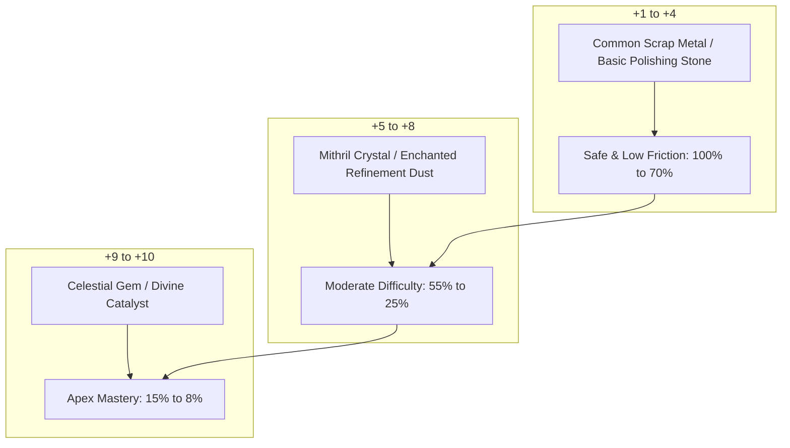

# 04 — Equipment Upgrading: +0 to +10 Refinement System

## 1. System Vision & Design Directives

In classic action MMORPGs, equipment refinement is the ultimate long-term aspirational loop. As an item advances from $+0$ toward **$+10$**, it gains both substantial combat potency and an escalating visual aura—culminating in a transcendent radiance in Three.js.

### 1.1 Non-Negotiable Core Directives
1. **Zero Item Destruction or Loss:** An upgrade attempt **never breaks, destroys, or deletes** the equipment item under any circumstance.
2. **Zero Level Regression (No Rollbacks):** A failed attempt **never reduces the upgrade level** (e.g., a failed $+8 \to +9$ attempt leaves the item safely at $+8$).
3. **Cumulative Pity / Failstack System:** Each consecutive failed attempt on an item increases the base success probability of subsequent attempts by a fixed cumulative increment until the upgrade succeeds, guaranteeing progression over time.
4. **Three Distinct Material Tiers:**
   - **Tiers +1 to +4 (Basic / Common):** Uses widely available scrap metal and basic polishing stones.
   - **Tiers +5 to +8 (Intermediate):** Uses refined mithril crystals and enchanted dust.
   - **Tiers +9 to +10 (Rare / Prestigious):** Uses rare Celestial Gems and Divine Catalysts.
5. **The +10 Cap:** Maximum refinement ceiling is established at **$+10$**.

### 1.2 Dual Pathways of Gear Evolution: iLvl Infusion vs. +0 to +10 Refinement
CrusadersOnline separates equipment progression into two independent, complementary systems:
- **Item Level Infusion (Base Stat Scaling):** Items drop with an initial `iLvl` matching the monster's level (e.g. *Thunderous Hammer* @ iLvl 28). Players can increase the item's `iLvl` step-by-step (+1 level at a time) up to their current character level at the Blacksmith, raising base damage and protection.
- **Equipment Refinement (+0 to +10 Multiplicative Scaling):** Multiplies the iLvl-derived base stats by $+4\%$ to $+50\%$, unlocking the escalating visual glow shaders in Three.js and functioning as the primary gold/material sink.

---

## 2. Upgrade Progression & Material Taxonomy (+0 to +10)



### 2.1 Refinement Probability, Costs & Failstack Increment Table

- **Base Success Rate ($P_{\text{base}}$):** The initial probability of succeeding on an attempt.
- **Failstack Increment ($\Delta P$):** The bonus success probability added to the item's failstack pool upon each failure.
- **Failstack Cap ($P_{\text{max}}$):** The maximum cumulative probability ceiling achievable through failstacks ($100\%$ guarantees success after a defined number of failures).
- **Consequence of Failure:** The item **remains at its current level**; upgrade materials and gold are consumed; Failstack increments by $+\Delta P$.

| Target Level | Material Stage | Primary Catalyst | Gold Cost | Base Chance ($P_{\text{base}}$) | Failstack Bonus per Fail ($\Delta P$) | Max Guaranteed Fails (Pity) | Cumulative Base Power Gain |
|---|---|---|---:|---:|---:|---:|---:|
| **+1** | Stage 1 (Common) | $2\times$ Iron Scrap | $100\text{ g}$ | $100\%$ | — | $0$ (Instant) | $+4\%$ |
| **+2** | Stage 1 (Common) | $4\times$ Iron Scrap | $250\text{ g}$ | $100\%$ | — | $0$ (Instant) | $+8\%$ |
| **+3** | Stage 1 (Common) | $6\times$ Iron Scrap | $500\text{ g}$ | $85\%$ | $+15\%$ | $1 \text{ fail}$ | $+12\%$ |
| **+4** | Stage 1 (Common) | $8\times$ Polishing Stone | $1,000\text{ g}$ | $70\%$ | $+10\%$ | $3 \text{ fails}$ | $+16\%$ |
| **+5** | Stage 2 (Intermediate) | $10\times$ Mithril Crystal | $2,500\text{ g}$ | $55\%$ | $+7.5\%$ | $6 \text{ fails}$ | $+21\%$ |
| **+6** | Stage 2 (Intermediate) | $14\times$ Mithril Crystal | $5,000\text{ g}$ | $40\%$ | $+6.0\%$ | $10 \text{ fails}$ | $+26\%$ |
| **+7** | Stage 2 (Intermediate) | $18\times$ Enchanted Dust | $9,000\text{ g}$ | $30\%$ | $+5.0\%$ | $14 \text{ fails}$ | $+31\%$ |
| **+8** | Stage 2 (Intermediate) | $24\times$ Enchanted Dust | $16,000\text{ g}$ | $20\%$ | $+4.0\%$ | $20 \text{ fails}$ | $+36\%$ |
| **+9** | Stage 3 (Rare) | $2\times$ Celestial Gem | $30,000\text{ g}$ | $12\%$ | $+2.5\%$ | $36 \text{ fails}$ | $+42\%$ |
| **+10** | Stage 3 (Rare) | $5\times$ Divine Catalyst | $60,000\text{ g}$ | $6\%$ | $+1.5\%$ | $63 \text{ fails}$ | **+50%** |

---

## 3. Mathematical Expectation with Cumulative Failstacks

Under the Failstack system, each failure increases success probability linearly until hitting $100\%$. The probability of succeeding on the $k$-th attempt ($k \ge 1$) given $k-1$ previous failures is:

$$P(\text{Success on attempt } k) = \min\left(1.0, P_{\text{base}} + (k - 1) \cdot \Delta P\right)$$

Let $p_k = P(\text{Success on attempt } k)$. The cumulative probability of failing the first $m$ attempts is:
$$Q_m = \prod_{k=1}^{m} (1 - p_k)$$

The expected number of attempts $E[N]$ to transition from level $L$ to $L+1$ is:
$$E[N] = 1 + \sum_{m=1}^{\infty} Q_m$$

Because $p_k$ reaches $1.0$ at a finite $k_{\text{max}} = \left\lceil \frac{1.0 - P_{\text{base}}}{\Delta P} \right\rceil + 1$, the series is strictly finite and bounded.

### 3.1 Expected Attempts & Resource Burn per Level

| Transition | Base Chance | Failstack Step | Expected Attempts $E[N]$ | Expected Gold Burn | Expected Material Burn |
|---|---|---|---:|---:|---|
| **+0 $\to$ +1** | $100\%$ | — | **$1.00$** | $100\text{ g}$ | $2\times$ Iron Scrap |
| **+1 $\to$ +2** | $100\%$ | — | **$1.00$** | $250\text{ g}$ | $4\times$ Iron Scrap |
| **+2 $\to$ +3** | $85\%$ | $+15\%$ | **$1.15$** | $575\text{ g}$ | $6.9\times$ Iron Scrap |
| **+3 $\to$ +4** | $70\%$ | $+10\%$ | **$1.37$** | $1,370\text{ g}$ | $11.0\times$ Polishing Stone |
| **+4 $\to$ +5** | $55\%$ | $+7.5\%$ | **$1.72$** | $4,300\text{ g}$ | $17.2\times$ Mithril Crystal |
| **+5 $\to$ +6** | $40\%$ | $+6.0\%$ | **$2.28$** | $11,400\text{ g}$ | $31.9\times$ Mithril Crystal |
| **+6 $\to$ +7** | $30\%$ | $+5.0\%$ | **$2.92$** | $26,280\text{ g}$ | $52.6\times$ Enchanted Dust |
| **+7 $\to$ +8** | $20\%$ | $+4.0\%$ | **$3.98$** | $63,680\text{ g}$ | $95.5\times$ Enchanted Dust |
| **+8 $\to$ +9** | $12\%$ | $+2.5\%$ | **$5.75$** | $172,500\text{ g}$ | $11.5\times$ Celestial Gem |
| **+9 $\to$ +10** | $6\%$ | $+1.5\%$ | **$9.61$** | $576,600\text{ g}$ | $48.1\times$ Divine Catalyst |
| **TOTAL +0 $\to$ +10** | — | — | **$\mathbf{30.78 \text{ attempts}}$** | **$\mathbf{\approx 858,055 \text{ Gold}}$** | Balanced across all 3 tiers |

### 3.2 Economic Analysis of the Failstack Architecture
- **Elimination of Player Rage-Quits:** In games with item breaking or degradation (e.g., standard Korean MMOs), a streak of bad luck can destroy 100 hours of progress in 10 seconds. In CrusadersOnline, every failure makes the next attempt strictly more likely to succeed.
- **Predictable Currency Siphoning:** While bounded, the aggregate gold sink ($\approx 858\text{k gold}$ per $+10$ item) ensures that veteran players continually drain hundreds of thousands of gold from the economy, permanently offsetting monster drop inflation.
- **Multi-Tier Gathering Stimulus:**
  - Novices sell Iron Scrap and Polishing Stones to fund early game progression.
  - Mid-level players harvest Mithril and Enchanted Dust.
  - End-game raiders buy Divine Catalysts derived from high-level boss salvaging.

---

## 4. Visual Progression & Three.js Shaders (+0 to +10)

The visual progression system provides instant readability of item power in Three.js WebGL:

```
[+0 to +2]   Natural metallic/leather texture (No Glow)
     |
[+3 to +4]   Polished Sheen (Emissive 0.3, Pale Silver/Bronze)
     |
[+5 to +6]   Azure Resonance (Emissive 0.7, 1.0 Hz Sine Pulse, Cyan Glow)
     |
[+7 to +8]   Amethyst Radiance (Emissive 1.3, 1.8 Hz Pulse, Violet Haze)
     |
[+9]         Solar Radiance (Emissive 2.0, Golden Flare, Orbiting Embers)
     |
[+10]        Transcendent Prismatic Aura (Emissive 2.8, Multi-Harmonic Prismatic Cycle + Crown Vortex)
```

| Level Tier | Glow Color | Emissive Intensity | Pulse Cycle | Particle Emitters |
|---|---|---|---|---|
| **+0 to +2** | None | $0.0$ | Static | None |
| **+3 to +4** | Pale Silver (`#CFD8DC`) | $0.35$ | Static | None |
| **+5 to +6** | Azure Cyan (`#00E5FF`) | $0.75$ | $1.0\text{ Hz}$ smooth pulse | Faint surface shimmer |
| **+7 to +8** | Royal Violet (`#D500F9`) | $1.30$ | $1.8\text{ Hz}$ energetic pulse | Rising magical spark points |
| **+9** | Solar Gold (`#FFD700`) | $2.00$ | $2.5\text{ Hz}$ harmonic pulse | Continuous orbiting gold embers |
| **+10 (MAX)** | Prismatic Opal (`#FFFFFF` + Rainbow tint) | $2.80$ | Dynamic multi-harmonic wave | **Crown Vortex:** 16 orbiting particle motes with trailing light ribbon |

### 4.1 Three.js Dynamic Shader Implementation

```typescript
import * as THREE from 'three';

export function updateWeaponGlow(mesh: THREE.Mesh, upgradeLevel: number, delta: number): void {
  const mat = mesh.material as THREE.MeshStandardMaterial;
  if (!mat || upgradeLevel < 3) return;

  mesh.userData.glowTime = (mesh.userData.glowTime || 0) + delta;
  const t = mesh.userData.glowTime;

  switch (true) {
    case upgradeLevel <= 4: // +3 to +4: Common
      mat.emissive.setHex(0xCFD8DC);
      mat.emissiveIntensity = 0.35;
      break;

    case upgradeLevel <= 6: // +5 to +6: Intermediate 1
      mat.emissive.setHex(0x00E5FF);
      mat.emissiveIntensity = 0.55 + 0.25 * Math.sin(t * 1.0 * Math.PI * 2);
      break;

    case upgradeLevel <= 8: // +7 to +8: Intermediate 2
      mat.emissive.setHex(0xD500F9);
      mat.emissiveIntensity = 0.90 + 0.40 * Math.sin(t * 1.8 * Math.PI * 2);
      break;

    case upgradeLevel === 9: // +9: Rare
      mat.emissive.setHex(0xFFD700);
      mat.emissiveIntensity = 1.40 + 0.60 * Math.sin(t * 2.5 * Math.PI * 2);
      break;

    case upgradeLevel >= 10: // +10: Apex Transcendent
      // Prismatic color cycling in HSL
      const hue = (t * 0.2) % 1.0;
      mat.emissive.setHSL(hue, 0.9, 0.6);
      mat.emissiveIntensity = 1.80 + 0.90 * Math.sin(t * 3.2 * Math.PI * 2);
      break;
  }
}
```

---

## 5. Server-Side Upgrade Execution & Failstack State

Failstacks are stored directly on the item instance record in the database:

```sql
-- Schema addition in inventory_items
ALTER TABLE inventory_items 
ADD COLUMN upgrade_level INT NOT NULL DEFAULT 0 CHECK (upgrade_level >= 0 AND upgrade_level <= 10),
ADD COLUMN failstack_bonus FLOAT NOT NULL DEFAULT 0.0 CHECK (failstack_bonus >= 0.0);
```

### 5.1 Upgrade Execution Engine (Pseudocode)

```typescript
export async function executeRefinementAttempt(
  db: Kysely<Database>,
  characterId: string,
  itemInstanceId: string
): Promise<{ success: boolean; newLevel: number; newFailstack: number }> {
  return await db.transaction().execute(async (trx) => {
    // 1. Lock item row
    const item = await trx
      .selectFrom('inventory_items')
      .selectAll()
      .where('id', '=', itemInstanceId)
      .where('character_id', '=', characterId)
      .forUpdate()
      .executeTakeFirstOrThrow();

    if (item.upgrade_level >= 10) throw new Error('Item is already at maximum level (+10)');

    const config = REFINEMENT_CONFIG[item.upgrade_level];
    
    // 2. Lock character and verify gold & materials
    const char = await trx
      .selectFrom('characters')
      .select(['id', 'gold'])
      .where('id', '=', characterId)
      .forUpdate()
      .executeTakeFirstOrThrow();

    if (char.gold < config.goldCost) throw new Error('Insufficient gold');
    await consumeRequiredMaterials(trx, characterId, config.materials);

    // 3. Deduct gold
    await trx
      .updateTable('characters')
      .set({ gold: char.gold - config.goldCost })
      .where('id', '=', characterId)
      .execute();

    // 4. Calculate final probability with failstack
    const effectiveChance = Math.min(1.0, config.baseChance + item.failstack_bonus);
    const roll = Math.random();

    if (roll < effectiveChance) {
      // SUCCESS: Increment level, reset failstack to 0
      const newLevel = item.upgrade_level + 1;
      await trx
        .updateTable('inventory_items')
        .set({ upgrade_level: newLevel, failstack_bonus: 0.0 })
        .where('id', '=', itemInstanceId)
        .execute();

      return { success: true, newLevel, newFailstack: 0.0 };
    } else {
      // FAILURE: Level preserved! Accumulate failstack pity bonus
      const newFailstack = item.failstack_bonus + config.failstackIncrement;
      await trx
        .updateTable('inventory_items')
        .set({ failstack_bonus: newFailstack })
        .where('id', '=', itemInstanceId)
        .execute();

      return { success: false, newLevel: item.upgrade_level, newFailstack };
    }
  });
}
```
