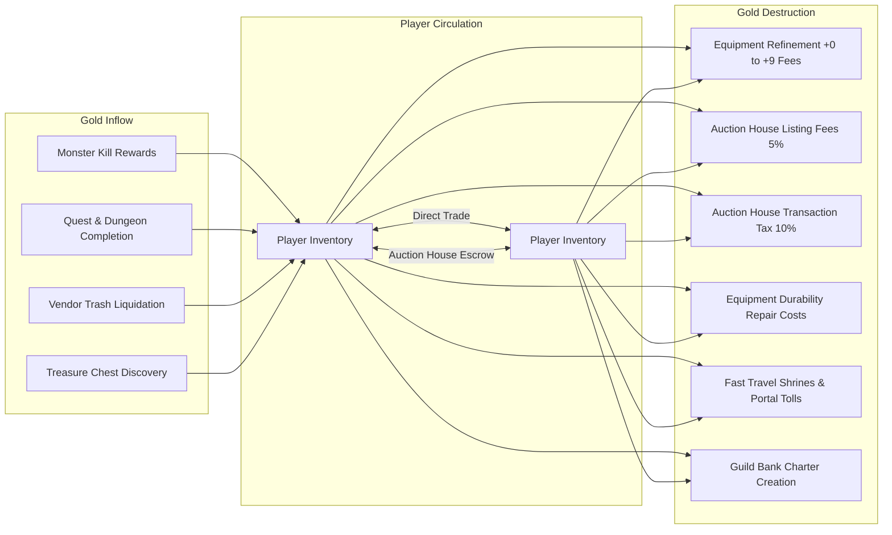
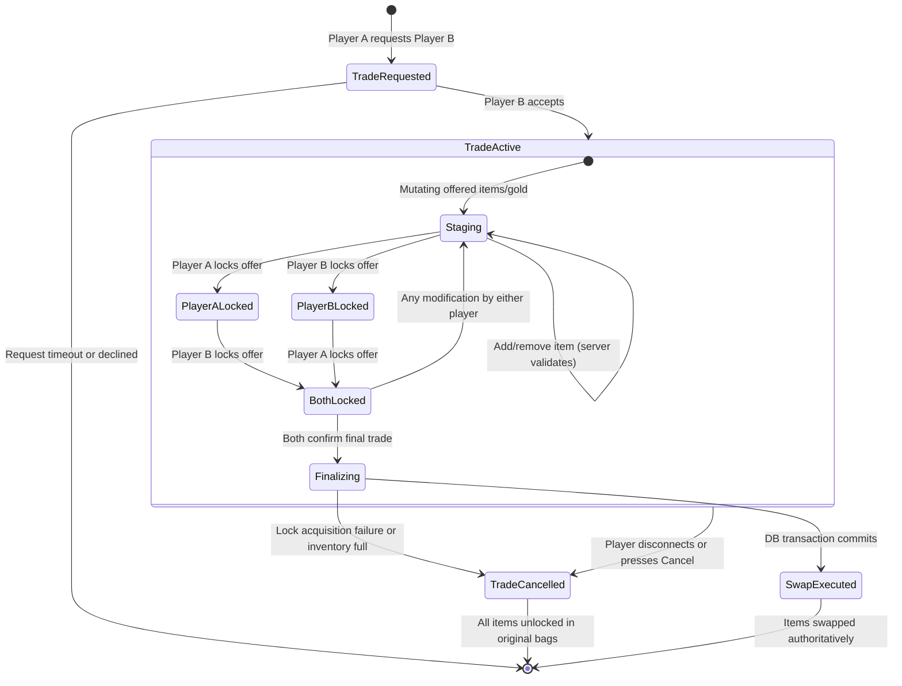

# 05 — Player Trading, Auction House & Economy Architecture

## 1. Macroeconomic Model: Faucets, Sinks & Velocity

A healthy virtual economy requires a balanced equation between **Currency Faucets** (mechanisms that mint new gold) and **Currency Sinks** (mechanisms that permanently destroy gold). Without aggressive and natural sinks, gold accumulation leads inevitably to runaway hyperinflation, rendering new players unable to purchase basic gear on the open market.



---

## 2. Direct Player-to-Player Trading

### 2.1 The Two-Phase Commit Security Protocol
Direct trading is the primary attack vector for item duplication exploits in online RPGs (e.g., race conditions, forced client crashes, packet replay, or desynchronized inventory slots).

To guarantee $100\%$ transactional safety:
1. **Zero Client Trust:** The client displays only server-validated representations of the trade window.
2. **Two-Stage Affirmation:**
   - **Stage 1 (Offer Lock):** Player A and Player B offer items and gold, then press `Lock Offer`. Once locked, items cannot be added or removed without breaking the lock.
   - **Stage 2 (Final Acceptance):** Both players must click `Finalize Trade`. If **either** player modifies their offer or disconnects, the entire trade reverts instantly to `Unlocked`, resetting all confirmations.
3. **Capacity Pre-Flight Verification:** The server verifies that Player A's bag has sufficient spatial grid volume to hold Player B's items, and vice versa. If space is insufficient, the trade is rejected with an explicit error.
4. **Database Row-Level Atomic Swap:** The swap is executed within a single PostgreSQL transaction with `FOR UPDATE` locks on both character inventory records.

### 2.2 Trade State Machine



---

## 3. Centralized Auction House Specification

The Auction House (AH) provides an asynchronous, zone-independent public marketplace accessible at town brokers.

### 3.1 Listing Rules & Anti-Speculation Sinks
1. **Non-Refundable Listing Fee:** A flat deposit equal to **$5\%$ of the listing price** is deducted immediately upon listing. If the auction expires unsold or is cancelled by the seller, the $5\%$ fee is permanently destroyed. This completely eliminates listing spam, artificial buyout inflation, and storage abuse.
2. **Sale Transaction Tax:** Upon a successful buyout or bid settlement, the server deducts a **$10\%$ transaction tax** from the proceeds delivered to the seller.
3. **Duration Windows:** Listings can be created for 12, 24, or 48 hours. Longer durations require proportionately higher deposit multipliers ($1.0\times, 1.5\times, 2.0\times$).
4. **Escrow Custody:** While an item is listed, it is removed from the player's inventory and assigned to the server's AH Escrow Vault (`owner_id = NULL`, `escrow_type = 'AUCTION'`). The seller cannot access or duplicate the item while listed.

### 3.2 Anti-Sniping & Market Manipulation Controls
- **Anti-Sniping Dynamic Extension:** If a bid is placed within the final $5\text{ minutes}$ of an auction, the expiration timestamp is automatically extended by an additional $5\text{ minutes}$. This eliminates automated sniping bots that execute at $0.1\text{ s}$ before expiration.
- **Price Velocity Circuit Breakers:** An item cannot be listed for more than $500\%$ of its 7-day rolling average market price without triggering an automated fraud/collusion audit flag.
- **Concurrent Active Listing Limits:** A character can maintain a maximum of **15 active listings** simultaneously.

---

## 4. Item Binding Taxonomy & Economic Flow

To preserve the value of crafting and dungeon exploration without turning every rare drop into a permanent, tradeable commodity that inflates the market forever, equipment uses a strict 4-tier binding taxonomy:

| Binding Tier | Description & Rules | Progression Role |
|---|---|---|
| **Unbound (Tradeable)** | Can be traded directly or listed on the Auction House indefinitely. | Raw crafting materials, common ores, gems, consumables, and unrefined weapons. |
| **Bind-on-Equip (BoE)** | Fully tradeable while in inventory; becomes permanently bound to character upon being placed in an active equipment slot. | World drop rares, Tempered tier gear, crafted epic weapons. Fosters an active gear market while removing items from circulation once used. |
| **Bind-on-Pickup (BoP)** | Bound to the looting character immediately upon being claimed. Cannot be traded or listed on the AH. | Raid boss trophies, Legendary quest rewards, high-tier dungeon drops. Requires personal achievement. |
| **Account-Bound** | Cannot be traded to other players, but can be transferred between characters on the same account via Account Bank. | Heirloom leveling gear, cosmetic titles, achievement rewards. |

---

## 5. Database Schema & Transactional Safety

All trading and auction mutations use PostgreSQL 18 with explicit row-level locks (`SELECT ... FOR UPDATE`).

### 5.1 SQL Schema Migration (Kysely Compatible)

```sql
-- Migration: 006_economy_trading_and_auctions.sql

-- Auction Listings Table
CREATE TABLE auction_listings (
    id UUID PRIMARY KEY DEFAULT gen_random_uuid(),
    seller_character_id UUID NOT NULL REFERENCES characters(id) ON DELETE CASCADE,
    item_instance_id UUID NOT NULL UNIQUE REFERENCES inventory_items(id) ON DELETE RESTRICT,
    starting_bid INT NOT NULL CHECK (starting_bid > 0),
    buyout_price INT CHECK (buyout_price >= starting_bid),
    current_high_bid INT DEFAULT NULL,
    current_bidder_character_id UUID REFERENCES characters(id) ON DELETE SET NULL,
    listing_fee INT NOT NULL,
    created_at TIMESTAMP WITH TIME ZONE DEFAULT CURRENT_TIMESTAMP,
    expires_at TIMESTAMP WITH TIME ZONE NOT NULL,
    status VARCHAR(16) NOT NULL DEFAULT 'ACTIVE' CHECK (status IN ('ACTIVE', 'COMPLETED', 'EXPIRED', 'CANCELLED'))
);

-- Mailbox & Escrow Claims Table
CREATE TABLE player_mailbox (
    id UUID PRIMARY KEY DEFAULT gen_random_uuid(),
    recipient_character_id UUID NOT NULL REFERENCES characters(id) ON DELETE CASCADE,
    sender_name VARCHAR(32) NOT NULL DEFAULT 'Auction Broker',
    subject VARCHAR(64) NOT NULL,
    attached_item_id UUID REFERENCES inventory_items(id) ON DELETE SET NULL,
    attached_gold INT NOT NULL DEFAULT 0 CHECK (attached_gold >= 0),
    sent_at TIMESTAMP WITH TIME ZONE DEFAULT CURRENT_TIMESTAMP,
    claimed_at TIMESTAMP WITH TIME ZONE DEFAULT NULL,
    expires_at TIMESTAMP WITH TIME ZONE NOT NULL
);

-- Financial Transaction Audit Log
CREATE TABLE transaction_audit_log (
    id UUID PRIMARY KEY DEFAULT gen_random_uuid(),
    transaction_type VARCHAR(32) NOT NULL, -- 'DIRECT_TRADE', 'AUCTION_BUYOUT', 'REFINE_UPGRADE'
    actor_character_id UUID NOT NULL REFERENCES characters(id),
    target_character_id UUID REFERENCES characters(id),
    gold_transferred INT NOT NULL DEFAULT 0,
    item_instance_id UUID,
    metadata JSONB NOT NULL DEFAULT '{}'::jsonb,
    created_at TIMESTAMP WITH TIME ZONE DEFAULT CURRENT_TIMESTAMP
);

CREATE INDEX idx_auction_status_expires ON auction_listings(status, expires_at);
CREATE INDEX idx_mailbox_recipient_unclaimed ON player_mailbox(recipient_character_id) WHERE claimed_at IS NULL;
CREATE INDEX idx_audit_actor ON transaction_audit_log(actor_character_id, created_at);
```

### 5.2 Atomic Buyout Transaction (Kysely Pseudocode)

```typescript
export async function executeAuctionBuyout(
  db: Kysely<Database>,
  buyerCharId: string,
  listingId: string
): Promise<void> {
  await db.transaction().execute(async (trx) => {
    // 1. Lock auction listing row
    const listing = await trx
      .selectFrom('auction_listings')
      .selectAll()
      .where('id', '=', listingId)
      .where('status', '=', 'ACTIVE')
      .forUpdate()
      .executeTakeFirstOrThrow();

    if (!listing.buyout_price) throw new Error('Auction does not have buyout');

    // 2. Lock buyer character record to verify and deduct gold
    const buyer = await trx
      .selectFrom('characters')
      .select(['id', 'gold'])
      .where('id', '=', buyerCharId)
      .forUpdate()
      .executeTakeFirstOrThrow();

    if (buyer.gold < listing.buyout_price) throw new Error('Insufficient gold');

    // Deduct gold from buyer
    await trx
      .updateTable('characters')
      .set({ gold: buyer.gold - listing.buyout_price })
      .where('id', '=', buyerCharId)
      .execute();

    // 3. Mark auction completed
    await trx
      .updateTable('auction_listings')
      .set({ status: 'COMPLETED' })
      .where('id', '=', listingId)
      .execute();

    // 4. Calculate seller proceeds (deduct 10% tax sink)
    const netProceeds = Math.floor(listing.buyout_price * 0.90);

    // Deliver gold to seller mailbox
    await trx
      .insertInto('player_mailbox')
      .values({
        recipient_character_id: listing.seller_character_id,
        sender_name: 'Auction House',
        subject: 'Item Sold: Buyout Settlement',
        attached_gold: netProceeds,
        expires_at: new Date(Date.now() + 30 * 86400000), // 30 days
      })
      .execute();

    // Deliver item to buyer mailbox
    await trx
      .insertInto('player_mailbox')
      .values({
        recipient_character_id: buyerCharId,
        sender_name: 'Auction House',
        subject: 'Auction Won',
        attached_item_id: listing.item_instance_id,
        expires_at: new Date(Date.now() + 30 * 86400000),
      })
      .execute();

    // 5. Append immutable audit record
    await trx
      .insertInto('transaction_audit_log')
      .values({
        transaction_type: 'AUCTION_BUYOUT',
        actor_character_id: buyerCharId,
        target_character_id: listing.seller_character_id,
        gold_transferred: listing.buyout_price,
        item_instance_id: listing.item_instance_id,
        metadata: JSON.stringify({ listingId, netProceeds, taxBurned: listing.buyout_price - netProceeds }),
      })
      .execute();
  });
}
```
