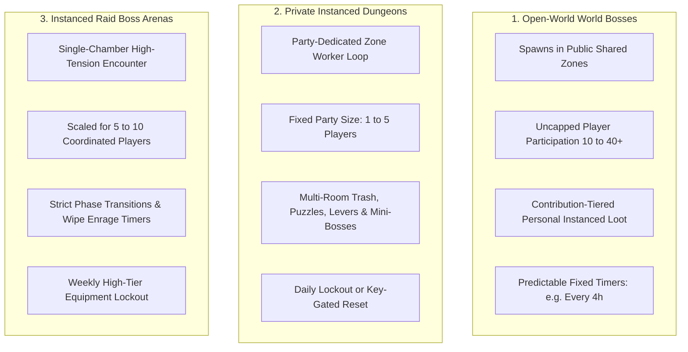

# 06 — Boss Raids, Instanced Dungeons & Group Encounters

## 1. Group Content Typology & World Topology

To satisfy both organic open-world social interaction and high-coordination tactical combat, CrusadersOnline implements three distinct encounter structures:



---

## 2. Instance Models & Server Topology Evaluation

| Model | Mechanics | Technical & Social Trade-offs | Exploit Potential | Recommendation |
|---|---|---|---|---|
| **A. Public Shared Encounters** | Boss lives in public zone; all players attack simultaneously. | Maximum social visibility; zero instance overhead. | High-level guilds monopolize spawns; low-end clients suffer FPS drops in Three.js. | Use strictly for **Open-World Roaming Bosses**. |
| **B. Leader-Hosted Instances** | Instance state tied to the party leader's character record. | Simple tracking. | Disbanding party kicks members; leader disconnect resets progress for 4 other players. | **Rejected** |
| **C. Matchmaking Ephemeral Pools** | Central server spawns anonymous match rooms across servers. | Low queue friction for casuals. | Destroys local server community; encourages toxic behavior and instant quitting. | **Deferred / Non-Goal** |
| **D. Party-Leased Dedicated Zone Workers** | A dedicated `worker_thread` zone is spawned on demand for a registered Party UUID. | Complete isolation; clean 20 Hz simulation tick rate; authoritative pause/reconnect window. | Higher server RAM footprint ($40\text{ MB}$ per active instance). | **RECOMMENDED PRIMARY** |

### 2.1 The Party-Leased Worker Lifecycle
1. **Creation:** When a 1–5 player party crosses a dungeon entrance trigger (e.g., Catacombs Crypt Gate), the Game Gateway provisions a new ephemeral zone instance in a worker thread.
2. **Lease Heartbeat:** The zone worker maintains a $10\text{-minute}$ empty-state timeout. If all party members disconnect or exit, the instance remains paused in memory for $5\text{ minutes}$ to allow reconnection before executing a graceful teardown.
3. **Save Points:** Dungeon boss defeats write immediate progress flags to `characters.progress_flags` (`catacombs_boss_cleared:2026-10-18`), preventing lockout re-entry exploits.

---

## 3. Encounter Mechanics Design (Beyond Pure DPS)

In CrusadersOnline, combat is animation-driven and physically simulated. Boss encounters are designed around movement, active blocking, and spatial awareness rather than generic bullet-sponge hit point pools.

```
       [Boss Cleave Arc: 120° Red Visual Cone (Must be Blocked or Evaded)]
                                  \
                                   \
   [Player 1: Tank]  -------->  [ BOSS ]  <-------- [Player 3: Ranged Caster]
   (Holds Frontal Shield Block)    /   \
                                  /     \
                                 /       \
      [Player 2: Flanking Melee DPS]    [Floor Hazard: Rising Floor Spikes]
```

### 3.1 Encounter Design Toolset
1. **Telegraph Decals & Dynamic Warning Cones:**
   - Ground projection decals rendered in Three.js ($0.8\text{ s}$ to $2.0\text{ s}$ wind-up) indicating impending AoE slams, breath cones, or falling debris.
   - Distinct color coding: **Red Decal** = unblockable heavy attack (must dodge/roll); **Yellow Decal** = blockable physical cleave (tank must hold shield).
2. **Interruptible Spell Wind-Ups:**
   - Bosses charging high-damage spells display an active channeling bar over their health plate.
   - Applying a **Shield Rush** or heavy Bash attack during the wind-up triggers the original flinch mechanic (`flinch >= 0.7`), breaking the spell and causing a $2.5\text{ s}$ stagger window where the boss takes $+25\%$ damage.
3. **Elemental Phase Shifts:**
   - Bosses alternate elemental shields (e.g., Fire Aura absorbs all physical and fire damage; susceptible exclusively to `WATER` and `EARTH` spells). This forces multi-class diversity and strategic spell selection.
4. **Interactive Arena Mechanics (Heritage Features):**
   - Incorporating original level props: using levers to activate ceiling crushers onto the boss, or maneuvering the boss into electrical relays to strip their invulnerability shield.
5. **Soft vs. Hard Enrage Timers:**
   - **Soft Enrage ($T > 6 \text{ min}$):** The boss gains $+10\%$ attack speed and $+10\%$ damage every $30\text{ seconds}$ until overwhelming the party.
   - **Hard Enrage ($T = 9 \text{ min}$):** The boss channels an arena-wide unblockable apocalypse spell that wipes the party.

---

## 4. Exemplar Encounter Specification: The Crypt Overlord (Catacombs Depth)

- **Setting:** Deep subterranean crypt below the Catacombs.
- **Party Size:** 3 to 5 players (Recommended Level 25–30).
- **Archetype / Base Model:** Corrupted Heavy Brute (Model 72) with Flaming Greatsword and Dark Shield.
- **Total HP:** $45,000\text{ HP}$ (Medium Difficulty baseline).

### 4.1 Encounter Phases

| Phase | Health Threshold | Boss Mechanics | Party Strategy & Required Counters |
|---|---|---|---|
| **Phase 1** | $100\% \to 75\%$ | **Heavy Cleave:** $110^\circ$ swing, $45\text{ Slash damage}$. **Shield Bash:** Knocks back tank. | Tank anchors boss facing away from party. Flankers attack from rear arc. |
| **Phase 2** | $75\% \to 40\%$ | **Unholy Whirlwind:** Boss spins across the room; leaves lingering dark flame trails. **Summon Adds:** 3 Skeleton Archers spawn on elevated ledges. | Ranged DPS must prioritize archers immediately. Tank maneuvers boss away from flame trails. |
| **Phase 3** | $40\% \to 0\%$ | **Soul Siphon:** Channeled beam targeting a random player, healing the boss $500\text{ HP/s}$. **Falling Portcullis:** Spikes drop from ceiling. | Party must coordinate a heavy Bash stagger within $2.0\text{ s}$ to interrupt the Siphon. Continuous dodging of floor spikes. |

---

## 5. Lockout, Reset & Reconnection Governance

### 5.1 Dungeon Lockout Model: Keystone Consumption
Rather than rigid calendar-based time gates (which frustrate players who can only play on weekends), CrusadersOnline utilizes an **Adventurer's Seal (Keystone)** system:
- Players earn $3\times$ Dungeon Seals per week through exploration, soft-skill crafting, and open-world bounties.
- Entering a high-tier dungeon consumes $1\times$ Seal upon the **defeat of the first boss**. Failed attempts before a boss kill do not consume the seal, allowing groups to learn encounters without penalty.
- Unlimited normal-difficulty runs are permitted for basic crafting materials, but high-tier Tempered/Legendary drops require a Keystone-sealed run.

### 5.2 Disconnect & Crash Handling
- **5-Minute Reservation:** If a player disconnects, their character avatar enters an invulnerable phased state for $30\text{ seconds}$ before despawning from the simulation. Their slot in the dungeon zone worker is reserved for $5\text{ minutes}$.
- **Mid-Combat Reconnect:** Upon logging back in within the reservation window, the player spawns directly at the entrance of the current boss chamber. If the boss fight is in progress, an impenetrable magical fog gate prevents them from entering until the current attempt succeeds or wipes.
- **Total Wipe Reset:** If all party members die, the boss resets to $100\%\text{ HP}$ and returns to its spawn anchor. Defeated trash mobs and previously cleared bosses remain dead.
