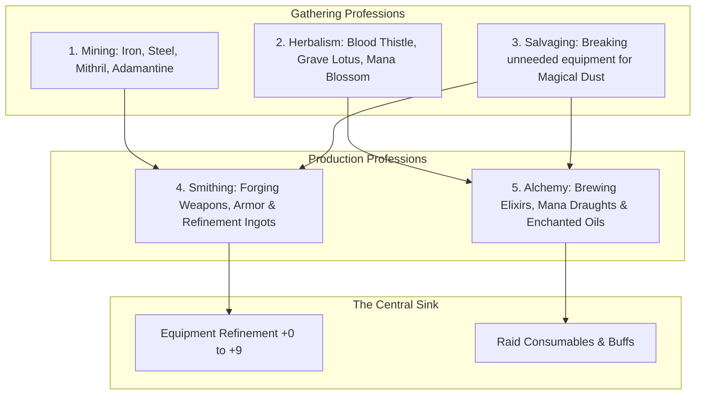
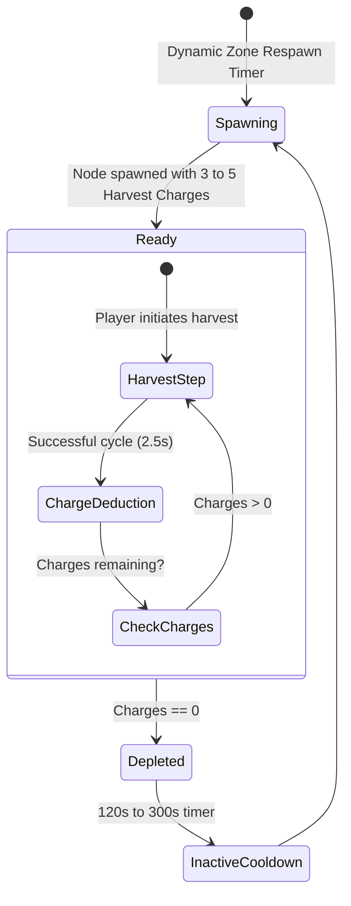

# 07 — Soft Skills, Gathering & Crafting Economy

## 1. System Vision & RuneScape-Style Non-Combat Progression

In persistent virtual worlds, non-combat "soft skills" provide crucial horizontal depth, economic foundation, and player retention. Rather than treating crafting as an afterthought UI menu that prints items from vendor components, CrusadersOnline adopts a **RuneScape-inspired skill progression** where gathering, refining, and fabricating form the backbone of the entire equipment refinement and consumable economy.

Non-combat skills are not mandatory chores for combat-focused players; rather, they enable dedicated gatherers, crafters, and merchants to build immense wealth, status, and economic leverage in the shared world.

---

## 2. Selected Skill Taxonomy

To maintain realistic implementation scope for a browser-based indie MMORPG, the skill set is focused on 5 deeply interconnected professions rather than dozens of redundant crafts:



### 2.1 Skill Profiles

| Skill | Category | Primary Tools | Resource Inputs | Output Deliverables | Direct Economic Role |
|---|---|---|---|---|---|
| **Mining** | Gathering | Pickaxes | Rock Outcrops & Veins | Raw Ores & Uncut Gems | Supplies raw metal for Smithing and $+0 \to +9$ refinement. |
| **Herbalism** | Gathering | Sickle | Botanical Flora | Wild Herbs & Sap | Supplies organic reagents for potions and weapon coatings. |
| **Salvaging** | Hybrid | Disenchanting Kit | Surplus Weapons & Armor | Magic Dust, Arcane Essence | The primary item sink: dissolves unwanted loot into upgrade catalysts. |
| **Smithing** | Production | Blacksmith Hammer | Refined Ingots + Flux | Base Equipment & Refinement Ingots | Crafts tradeable gear and high-tier refinement materials. |
| **Alchemy** | Production | Alchemical Alembic | Herbs + Monster Essences | Health/Mana Potions, Resistance Oils | Essential continuous consumable faucet for combat expeditions. |

---

## 3. Skill Progression Curve & Mathematics (Levels 1–100)

Soft skills progress across 100 discrete levels using an exponential formula inspired by classic RPG curves:

$$\text{XP Required for Level } L = \left\lfloor \frac{1}{4} \sum_{n=1}^{L-1} \left( n + 300 \times 2^{n / 7} \right) \right\rfloor$$

| Level Tier | Title / Rank | Cumulative XP | Key Unlock Capabilities |
|---|---|---:|---|
| **Level 1–25** | Apprentice | $0 \to 10,250$ | Iron Ore, Copper Veins, Minor Healing Draught, Bronze Forging. |
| **Level 26–50** | Journeyman | $10,251 \to 125,000$ | Steel Forging, Greater Healing Potions, Mid-Tier Salvaging Dust. |
| **Level 51–75** | Expert | $125,001 \to 850,000$ | Mithril Mining, Elemental Resistance Oils, Tempered Gear Crafting. |
| **Level 76–99** | Master | $850,001 \to 6,500,000$ | Adamantine Extraction, Celestial Catalysts, Legendary Weapon Forging. |
| **Level 100** | Grandmaster | $13,034,431$ | Masterwork Visual Glow; $100\%$ Refinement Salvage Yields. |

- **Character Level Independence:** Soft skill levels are independent of combat character level. A Level 15 character can achieve Level 90 Mining if they dedicate their time to gathering dangerous frontier nodes.

---

## 4. World Resource Node Lifecycle & Multi-Tap Architecture

In traditional MMOs, resource nodes are binary: the first player to click the node deprives all other players of it, triggering toxic competition, node-camping bots, and territorial griefing.

### 4.1 The Dynamic Multi-Tap Node Model
CrusadersOnline utilizes a **Multi-Tap Capacity Pool** for all world mineral veins and herb patches:



1. **Shared Harvest Charges:** A mineral vein spawns with $N = 3 \text{ to } 5$ charges. Multiple players can harvest the same node simultaneously without locking each other out. Each completed harvest cycle consumes 1 charge from the common pool.
2. **Zone Density Dynamic Rescaling:**
   $$\text{Respawn Time} = \frac{T_{\text{base}}}{\max(1.0, \sqrt{\text{Active Zone Players} / 10})}$$
   When player density increases, nodes respawn faster, preventing resource starvation in high-population zones.

---

## 5. Anti-Botting & Anti-Macro Interaction Mechanics

Automated botting scripts excel at clicking static pixel coordinates on fixed timers. To neutralize botting without punishing human players with obnoxious CAPTCHAs, gathering incorporates **Dynamic Micro-Interactions**:

```
[Gathering Node: Mithril Vein]
   |
   +---> Normal Harvest: 2.5s Progress Bar -> Grants 1x Ore, 25 XP
   |
   +---> [Dynamic Event: Fissure Shift (15% Chance)]
         A critical fracture opens at offset angle (+35°).
         - Human Player: Moves character or taps directional key -> Grants 2x Rare Gem.
         - Blind Macro/Bot: Ignores event -> Tools deflects with zero yield and 5s flinch.
```

1. **Variable Harvest Cycle Jitter:** Server applies a random $\pm 300\text{ ms}$ jitter to every harvest cycle. Predictable fixed-rate macros automatically de-synchronize from the server tick.
2. **Spatial Node Drift:** When a resource node respawns, its coordinates vary randomly within a $5.0\text{-meter}$ radius circle, preventing static coordinate click-spam bots.
3. **Diminishing Harvest Telemetry:** If a single character harvests nodes within the same $20\text{ m}$ sub-zone for $> 45\text{ consecutive minutes}$ without engaging in combat or movement transitions, yields decay by $10\%$ per cycle, signaling an automated loop.

---

## 6. Salvaging: The Vital Equipment Sink

One of the greatest dangers in an action RPG is the accumulation of millions of "vendor trash" weapons that flood inventories and inflate merchant gold.

**Salvaging** turns every low-tier drop into valuable crafting currency:
- Using a Blacksmith's Anvil or portable Salvaging Kit, players dissolve equipment:
  - **Battle-worn Item:** Yields $2 \text{ to } 4\times$ Scrap Metal / Iron Fragments.
  - **Mundane Item:** Yields $1 \text{ to } 3\times$ **Magic Dust** (essential for $+4 \to +6$ equipment refinement).
  - **Tempered Item:** Yields $1\times$ **Arcane Shard** and $1 \text{ to } 2\times$ **Celestial Gem Fragments**.
  - **Legendary Item:** Yields $1\times$ **Pure Celestial Gem** (required for $+7 \to +9$ refinement).

This ensures that high-level players actively buy cheap surplus equipment from novice players on the Auction House just to salvage them for upgrade reagents—creating an organic economic transfer from veterans to beginners.
