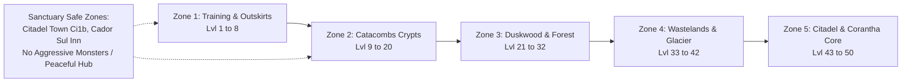
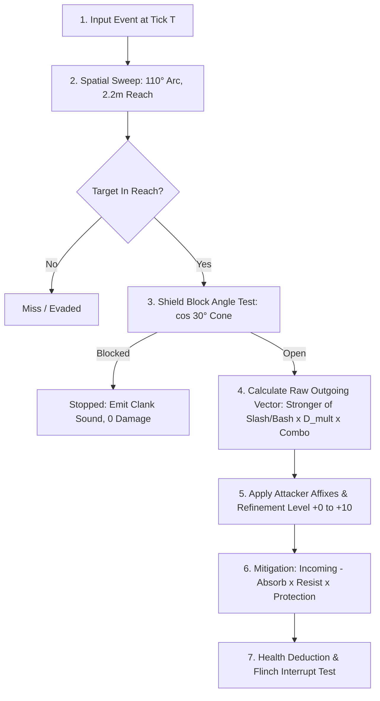
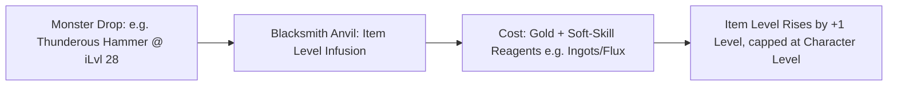

# 08 — Character Progression, World Zone Levels & Combat Balance

## 1. Grounding in the Original Engine Formulas

CrusadersOnline preserves the mathematical DNA of the 1999 *Crusaders of Might and Magic* engine recovered through reverse engineering (`docs/reverse-engineering/executable-analysis.md §7–8`, `shared/src/game/original_stats.ts`, and `ruleset.ts`). 

All player attributes, health pools, mana pools, damage multipliers, and resistance calculations derive from verified assembly routines, adapted with rigorous server-authoritative safeguards for multiplayer longevity.

---

## 2. World Zone & Monster Level Distribution (Levels 1 to 50)

In the original game, enemies scaled implicitly by story act. In CrusadersOnline, the persistent world is structured into **explicit Level Brackets (1 to 50)** mapped onto the actual geometric acts of the game.

### 2.1 Zone Level Mapping Table

| Region / Act Codes | In-Game Setting | Level Bracket | Resident Monster Archetypes | Zone Combat Rules |
|---|---|:---:|---|---|
| **`train`** | Training Grounds | **1 – 3** | Training Dummies, Weak Skeletons | Novice tutorial zone. Zero death penalty. |
| **`Cs1a`, `Cs1b`** | Cador Sul Outskirts | **4 – 8** | Skeleton Scouts, Outlaw Rogues | Open plains; introductory gathering nodes. |
| **`Ci1b`, `Cs1b-Inn`** | **Citadel Town & Inn** | **SAFE** | **None (Peaceful Town & Merchants)** | **Sanctuary Zone:** Combat disabled. No aggro. Doubled passive HP/Mana regen. Trading & AH hub. |
| **`Ca1a`, `Ca1b`, `Ca1c`** | Upper Catacombs | **9 – 14** | Skeleton Warriors, Skeleton Archers | Enclosed corridors; introductory levers and traps. |
| **`Ca2a`, `Ca3a`** | Deep Catacombs Crypts | **15 – 20** | Skeleton Ghosts, Bone Golems | Heavy bash damage; spellcaster enemies. |
| **`Du1a`, `Du1b`, `Du1c`** | Duskwood Outer Perimeter | **21 – 26** | Dasher Brutes, Dire Wolves, Bandits | Dense botanical gathering; fast ambushing enemies. |
| **`Du2a`, `Du3a`** | Duskwood Ogre Stronghold | **27 – 32** | Ogre Outlaws, Dark Mages | Elite mob packs; high physical cleaves. |
| **`Ws1a`, `Ws5a`** | Wasteland Plains | **33 – 37** | Corrupted Knights, Shadowstalkers | Wide open combat; mineral veins (Mithril). |
| **`Gl1a`, `Gl2a`** | Glacier Caverns | **38 – 42** | Ice Titans, Frost Revenants | Heavy frost resistance checks; freezing slows. |
| **`Ws9a`, `Co1a`** | Corantha Outer Bastion | **43 – 46** | Dark Masters, Citadel Golems | Group requirement; high magic burst damage. |
| **`Ci3b`, `Ci4b`, `Ci9a`** | **Necros' Inner Sanctum** | **47 – 50** | **Deceivers, Shadow Champions, Necros Guards** | **Apex Endgame:** Raids, Keystone dungeons, $+10$ catalyst drops. |

### 2.2 Sanctuary Safe Zone Rules
Zones designated as **Safe Zones / Sanctuaries** (such as the Citadel Royal Keep `Ci1b` and Cador Sul Village Inn `Cs1b-Inn`):
1. **Aggressive Monsters Prohibited:** No hostile entities can spawn or pathfind into sanctuary boundaries.
2. **Combat Lock:** Player attack swings, spells, and PvP interactions are disabled (`player.canAttack = false`).
3. **Passive Comfort Aura:** Characters standing within safe zones recover $+5\%\text{ Max HP}$ and $+5\%\text{ Max Mana}$ per second.
4. **Economic Anchorage:** Contains the Centralized Auction House broker, Blacksmith refining anvils, bank vaults, and crafting stations.

---

## 3. Character Attributes & Derived Stat Formulas

Characters possess 4 primary attributes, each subject to an authoritative hard cap of **50 points**:
- **Might ($M$):** Scales physical weapon damage multiplier.
- **Intellect ($I$):** Dictates maximum mana pool and spell scaling.
- **Endurance ($E$):** Scales maximum health pool and flinch resistance.
- **Speed ($S$):** Scales locomotion velocity, jump distance, and weapon swing rates.

### 3.1 The Master Derived Stat Equations

$$\begin{aligned}
\text{Max HP} &= 50 + 0.6 \times \text{Endurance} \times \text{Level} \\
\text{Max Mana} &= \left\lfloor \frac{\text{Intellect} \times \text{Level}}{3} \right\rfloor + 20 \\
\text{Damage Multiplier } (D_{\text{mult}}) &= \frac{\left\lfloor 10 \times (0.9 + 0.005 \times \text{Might} \times \text{Level}) \right\rfloor}{10} \\
\text{Speed Multiplier } (S_{\text{mult}}) &= 0.999 + 0.01 \times \text{Level} + \frac{(\text{Speed} - 15) \times 1.2 \times 0.5}{35}
\end{aligned}$$

---

## 4. The Authoritative Damage Resolution Pipeline

Every melee blow and spell projectile is processed through a deterministic 7-stage server pipeline:

### 4.1 Step-by-Step Formulations
1. **Raw Weapon Damage Vector:** Stronger of `SLASH` and `BASH`:
   $$D_{\text{weapon}} = \max(\text{Slash}, \text{Bash})$$
2. **Combo Attack Mode Multiplier:**
   - 1st & 2nd Swings: $1.0\times$
   - 3rd Combo Finisher: $\mathbf{1.25\times}$ (`ATTACK_MODE_SCALE.power`).
3. **Refinement Bonus (+0 to +10):**
   Scales from $+4\%$ at $+1$ up to **$+50\%$ at $+10$**:
   $$B_{\text{upgrade}} \in [0.04 \dots 0.50]$$
4. **Outgoing Raw Damage:**
   $$D_{\text{raw}} = \left[ D_{\text{weapon}} \times (1 + B_{\text{upgrade}}) \times M_{\text{rarity}} + \sum D_{\text{flat}} \right] \times D_{\text{mult}} \times \text{ComboMode} \times \left(1 + \sum P_{\text{percent}}\right)$$
5. **Mitigation Across the 11 Damage Types:**
   $$D_{\text{taken}, i} = \max(0, D_{\text{incoming}, i} - \text{Absorb}_i) \times \text{Resist}_i \times \prod \text{Protection}_{j, i}$$

---

## 5. Level Differential Modifiers & Asymptotic XP Pacing

When a combatant of level $L_{\text{attacker}}$ engages a target of level $L_{\text{target}}$, the level delta $\Delta L = L_{\text{attacker}} - L_{\text{target}}$ modifies combat and progression math:

1. **PvE Hit Chance / Grazing Blows (Punching Up):**
   - If $\Delta L \ge 0$: Full accuracy ($100\%$).
   - If $\Delta L < 0$ (Punching Up into higher-level monsters): Target gains an evasive glance defense:
     $$\text{Hit Chance} = \max\left(0.50, 1.0 - 0.05 \times |\Delta L|\right)$$
     Missed rolls register as "Glancing Blows" inflicting $50\%$ baseline damage.
2. **Zero Item Farming Penalties (Punching Down):**
   - **No Loot Lockouts:** Defeating lower-level monsters incurs **zero item drop rate reduction**. Farming materials, crafting reagents, and rare world drops from earlier maps is an essential and unpenalized pillar of character progression.
3. **Asymptotic Diminishing XP Curve (The Level 1 Grind Challenge):**
   - Slaying lower-level monsters yields progressively diminishing experience via an asymptotic power curve, but with a **permanent non-zero floor of $1\text{ XP}$**:
     $$\text{XP}_{\text{awarded}} = \max\left(1, \left\lfloor \text{BaseXP}(L_m) \times \left( \frac{L_m}{L_p} \right)^{2.2} \right\rfloor \right)$$
   - *Example:* A Level 1 Skeleton yields $5\text{ XP}$ to a Level 1 character, but drops to the minimum floor of $1\text{ XP}$ for characters above Level 15.
   - *Feasibility:* Reaching Level 50 requires $\approx 2,450,000\text{ cumulative XP}$. A player slaying exclusively Level 1 skeletons would require over $1.5\text{ million kills}$ to reach max level. It is extraordinarily difficult and time-intensive, but strictly and mathematically possible if a player chooses to pursue that path.

---

## 6. Item Level (iLvl) & The Item Level Infusion System

Equipment drops with an intrinsic **Item Level (`iLvl`)** that directly scales its baseline damage and protective values, decoupling initial monster level from long-term weapon viability.

### 6.1 Baseline Stat Scaling by iLvl
An item's base weapon damage and armor protection scale with its current `iLvl` ($1 \dots 50$):

$$\text{BaseStat}(iLvl) = \text{BaseStat}_{\text{catalog}} \times \left( 1.0 + 0.02 \times (iLvl - 1) \right)$$

- An Axe (base $5\text{ Slash} / 5\text{ Bash}$) at iLvl 1 has base $5.0 / 5.0$.
- At iLvl 25: $5.0 \times (1.0 + 0.02 \times 24) = 7.4\text{ Damage}$.
- At iLvl 50: $5.0 \times (1.0 + 0.02 \times 49) = 9.9\text{ Damage}$.

### 6.2 The Infusion Process (Leveling Up Gear)
1. **The Character Level Ceiling:** An item can be upgraded **1 level at a time ($+1\text{ iLvl}$)** at a Blacksmith's Anvil. An item's `iLvl` **can never exceed the character's current level** ($\text{iLvl} \le L_{\text{character}}$).
2. **Infusion Material & Currency Costs:**
   - **Gold Cost:** $\text{Gold} = 150 \times \text{Current iLvl}$.
   - **Soft-Skill Crafting Reagents:**
     - **iLvl 1–20:** $2\times$ Iron Ingot + $1\times$ Alchemical Flux
     - **iLvl 21–35:** $3\times$ Steel Ingot + $2\times$ Alchemical Flux
     - **iLvl 36–45:** $4\times$ Mithril Ingot + $1\times$ Infused Essence
     - **iLvl 46–50:** $5\times$ Adamantine Ingot + $2\times$ Divine Catalyst
3. **Preservation of Iconic Items:** A player who discovers an iconic weapon early (such as a Thunderous Hammer dropping at iLvl 28 from the Duskwood Ogre) can continuously infuse it step-by-step all the way to iLvl 50, keeping their favorite gear viable for endgame raiding without replacing it with generic high-level loot.

---

## 7. Path of Exile-Style Passive Skill Tree Integration

CrusadersOnline features an extensive web-based Passive Skill Tree granting **1 passive point per character level** (Levels 2 to 50 = **49 total points**).

The tree enables deep horizontal build differentiation across three structural node tiers:
1. **Minor Nodes:** Core attribute boosts (+1 Might, +10 HP, +2% Slash Damage).
2. **Notable Nodes:** Clustered archetype specializations (+15% Shield Block Cone, +12% Spell Penetration).
3. **Keystones (Mechanic Alterations):** Revolutionary playstyle transformations that introduce substantial trade-offs (e.g., **Paid in Blood**, which splits spell costs 50/50 between Mana and HP after cost reductions are applied).

*(For complete graph topology, node catalogues, and keystone specifications, see [13. Passive Skill Tree](13-passive-skill-tree.md).)*

---

## 8. Item Power Score (IPS) Specification (Updated for iLvl & +10)

$$\text{IPS} = \left( \text{BaseDamage}(iLvl) \times 3.0 + \sum \text{StatBonus} \times 2.0 + \text{ArmorPoints}(iLvl) \times 4.0 \right) \times (1 + 0.05 \times \text{UpgradeLevel}) \times R_{\text{tier}}$$

Where:
- $\text{BaseDamage}(iLvl)$ and $\text{ArmorPoints}(iLvl)$: Scaled by item level.
- $R_{\text{tier}}$: Battle-worn ($1.0$), Mundane ($1.2$), Tempered ($1.5$), Legendary ($2.0$).
- $\text{UpgradeLevel}$: $0 \dots 10$ ($+50\%$ max power boost at $+10$).
