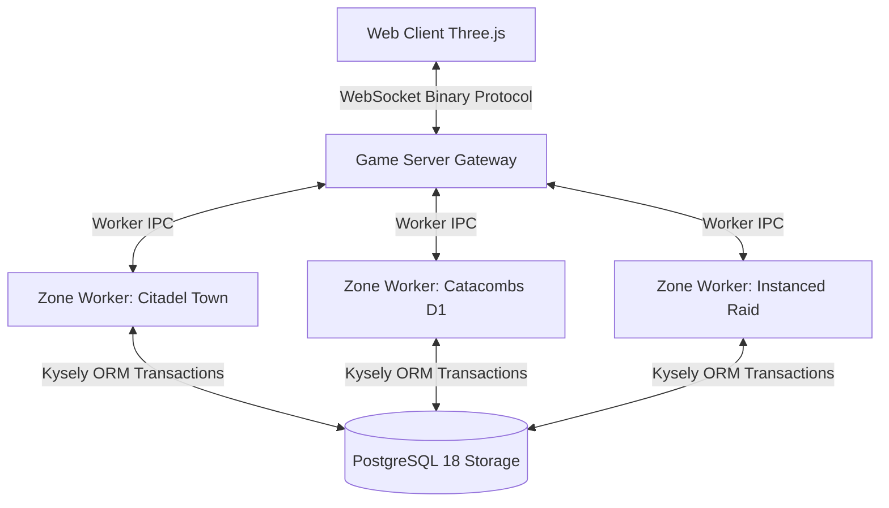

# 09 — World Simulation, Social Systems & Persistence Security

## 1. World Simulation Topology & Zone Workers

CrusadersOnline is built on a **Modular Monolith Zone Worker Architecture** (`docs/mmorpg-architecture.md`). The world is divided into discrete spatial zones (e.g., *Citadel*, *Catacombs*, *Duskwood*, *Stronghold*), each simulated by an independent Node.js `worker_thread` operating on a fixed **20 Hz tick loop** ($50\text{ ms}$ per simulation step).



### 1.1 Spatial Partitioning & Broadphase Optimization
- **Spatial Hash Grid:** Within each zone worker, entities are partitioned into a uniform **$32\text{m} \times 32\text{m}$ 2D spatial grid**.
- **Interest Management (AOI):** Clients receive position, animation, and combat updates exclusively for entities within their active cell and adjacent 8 neighboring cells ($96\text{m} \times 96\text{m}$ viewing envelope). This caps client bandwidth and Three.js draw call counts regardless of global zone population.

---

## 2. Server-Authoritative Input Simulation (Anti-Speedhack & Anti-Teleport)

Following ADR-006, **clients never transmit positions ($X, Y, Z$).** Clients transmit only raw inputs:

```typescript
export interface ClientInputPacket {
  clientTick: number;
  moveFlags: number; // WASD bits, Jump bit, Block bit, Swing bit
  yaw: number;       // Horizontal look angle
  pitch: number;     // Vertical aim angle
}
```

1. **Deterministic Rapier3D Movement:** The zone worker applies the inputs to the character's Rapier capsule controller. The resulting coordinates represent authoritative reality.
2. **Speed & Boundary Verification:** Because positions are derived entirely from server physics, client-side speedhacks, wall-hacks, and teleport injection scripts are structurally impossible.
3. **Lag Compensation & History Buffering:** The server retains a 20-tick ($1.0\text{ s}$) rolling history buffer of entity hitboxes. When an attack packet arrives referencing client tick $T_{\text{client}}$, the server rewinds hitboxes to that historical timestamp to verify line-of-sight and weapon cone intersection before executing damage.

---

## 3. Persistence Engine & Transactional Atomicity

### 3.1 Dual-Speed Write Architecture
To achieve high throughput without bogging down the 20 Hz tick loop in continuous disk I/O:
- **In-Memory Volatile Simulation:** Combat positions, monster HP, current mana, and movement velocity live entirely in zone worker RAM.
- **Dirty State Periodic Flush (60-Second Epoch):** Routine XP gains, minor gold increments, and durability loss are flagged "dirty" and committed in batches every $60\text{ seconds}$.
- **Immediate Synchronous DB Transactions:** Any high-stakes mutation triggers an immediate, blocking PostgreSQL transaction with row-level locking (`SELECT ... FOR UPDATE`):
  - Equipment equip/unequip/swap.
  - Item drops and ground pickups.
  - Direct player-to-player trades.
  - Auction House listings and settlements.
  - $+0 \to +9$ equipment refinement attempts.
  - Character zone-to-zone transitions.

### 3.2 Anti-Duplication Rule & Code Implementation

Every item mutation must lock the item row before updating coordinates or ownership:

```typescript
export async function transferItemSafely(
  db: Kysely<Database>,
  itemId: string,
  sourceCharId: string,
  targetCharId: string,
  targetSlotIndex: number
): Promise<void> {
  await db.transaction().execute(async (trx) => {
    // 1. Lock item row and verify current owner
    const item = await trx
      .selectFrom('inventory_items')
      .selectAll()
      .where('id', '=', itemId)
      .where('character_id', '=', sourceCharId)
      .forUpdate()
      .executeTakeFirstOrThrow(() => new Error('Item ownership mismatch or concurrent lock'));

    // 2. Lock target slot to prevent collision
    const existingSlotItem = await trx
      .selectFrom('inventory_items')
      .selectAll()
      .where('character_id', '=', targetCharId)
      .where('slot_index', '=', targetSlotIndex)
      .forUpdate()
      .executeTakeFirst();

    if (existingSlotItem) throw new Error('Target inventory slot already occupied');

    // 3. Execute authoritative transfer
    await trx
      .updateTable('inventory_items')
      .set({
        character_id: targetCharId,
        slot_index: targetSlotIndex,
        is_equipped: false,
      })
      .where('id', '=', itemId)
      .execute();
  });
}
```

---

## 4. Social Systems Architecture

### 4.1 Party System (1 to 5 Players)
- **Shared State Synchronization:** Party members broadcast real-time HP/Mana percentage, active status effects, and zone location to their teammates.
- **Range-Restricted XP Sharing:** Group XP sharing is active only while party members remain within $30.0\text{ meters}$ of the kill event.
- **Raid Conversion:** For open-world bosses, up to 4 parties can link into a **20-player Raid Cohort**, enabling cross-party buffing and unified threat communication.

### 4.2 Guild System & Monopolization Defenses
To prevent elite guilds from locking down world bosses and pricing casual players out of the economy:
1. **Instanced Mirror Fallbacks:** If an open-world boss zone exceeds 60 players, the server spins up a secondary zone mirror, preventing single guilds from blockading public content.
2. **Guild Member Cap:** Guilds are hard-capped at **50 active accounts**, preventing mega-alliances from monopolizing server resources.
3. **Guild Bank Vault:** 96-slot shared inventory secured with role-based withdrawal quotas and an immutable transactional audit log.

### 4.3 Chat & Anti-Spam Pipeline
- **Channel Hierarchy:** `Global` (Rate limited: 1 msg / 5s), `Zone` (1 msg / 2s), `Party` (Uncapped), `Guild` (Uncapped), `Whisper` (Mutual friends or open with anti-harassment block).
- **Automated Mute Heuristics:** Players posting $> 5$ identical messages within $10\text{ seconds}$ receive an automated $15\text{-minute}$ global chat suspension.
