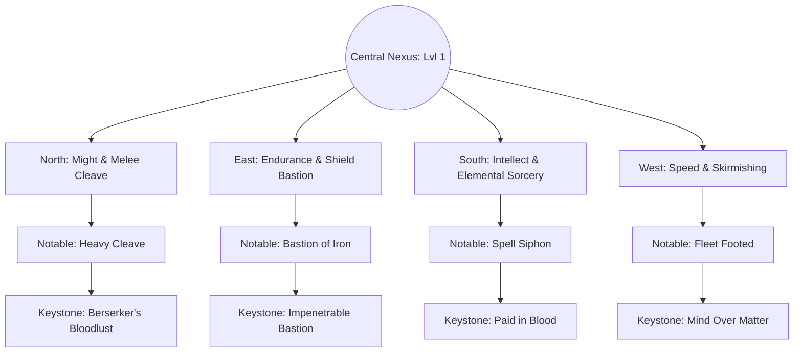

# 13 — Path of Exile-Style Passive Skill Tree Specification

## 1. Vision & Architectural Philosophy

To provide deep horizontal character customization without locking players into rigid character classes, CrusadersOnline implements a **web-based Passive Skill Tree inspired by *Path of Exile***.

Characters do not choose a static "Warrior" or "Mage" class upon creation. Instead, all characters begin at the center of a vast, interconnected passive constellation. As they earn **1 Passive Skill Point per character level** (Levels 2 to 50 = **49 total points**), they navigate outward through paths dedicated to Might (Physical Melee), Endurance (Armor & Shield Tanking), Intellect (Elemental & Dark Sorcery), and Speed (Agility, Cast Rate & Locomotion).



---

## 2. Node Classification & Anatomy

The Passive Skill Tree contains three discrete tiers of nodes:

| Node Type | Icon Geometry | Relative Frequency | Stat Magnitude & Role |
|---|---|---:|---|
| **Minor Nodes** | Small Circle ($16\text{px}$) | $\approx 120 \text{ nodes}$ | Incremental stat building (+1 Might, +10 HP, +2% Slash Damage, +1.5% Cast Speed). |
| **Notable Nodes** | Medium Diamond ($28\text{px}$) | $\approx 32 \text{ nodes}$ | Concentrated specialization boosts (+15% Shield Block Arc, +12% Spell Crit, +50 Armor). |
| **Keystones** | Large Star / Hexagon ($44\text{px}$) | **8 master nodes** | **Game-Changing Mechanical Alterations** with deliberate functional trade-offs. |

---

## 3. Keystone Master Specifications

Keystones fundamentally redefine the rules of combat and resource consumption.

### 3.1 Keystone: "Paid in Blood" (Blood Magic Hybrid)
- **Tagline:** *The arcane flame burns hotter when stoked with vital ichor.*
- **Effect:** **50% of all spell mana costs are paid in Health, and 50% are paid in Mana.**
- **Order of Operations & Calculation Rule:**
  All mana cost reductions (from gear affixes, passive skills, or buff elixirs) are **applied first** to determine the net effective cost. The resulting value is then split equally ($50 / 50$) between HP and Mana.

$$\begin{aligned}
\text{Net Cost} &= \left\lfloor \text{BaseManaCost} \times \left(1.0 - \sum \text{ReducedCost}_{\text{percent}}\right) \right\rfloor - \sum \text{FlatReduction} \\
\text{HP Deducted} &= \left\lceil \frac{\text{Net Cost}}{2} \right\rceil \\
\text{Mana Deducted} &= \left\lfloor \frac{\text{Net Cost}}{2} \right\rfloor
\end{aligned}$$

#### Concrete Worked Example:
- **Spell:** Fireball Level 2 (Base Cost: $30\text{ Mana}$).
- **Player Gear:** Ring of Archmage ($-10\%$ Mana Cost) + Suffix *of Efficiency* ($-10\%$ Mana Cost) = $-20\%$ Cost Reduction.
- **Calculation:**
  1. Net Cost: $30 \times (1.0 - 0.20) = \mathbf{24\text{ Cost}}$.
  2. With **Paid in Blood**:
     - $\text{HP Cost} = 24 / 2 = \mathbf{12\text{ HP}}$.
     - $\text{Mana Cost} = 24 / 2 = \mathbf{12\text{ Mana}}$.
- **Cast Failure Condition:** If the character has $< 12\text{ Mana}$ OR $< 13\text{ HP}$ (costs cannot reduce current HP to 0), the cast is rejected by the authoritative server.

---

### 3.2 Keystone: "Impenetrable Bastion"
- **Effect:** Frontal shield block cone expanded from $\pm 81^\circ$ ($\cos 30^\circ$) to a full **$180^\circ$ forward hemisphere** ($\cos 90^\circ$).
- **Trade-off:** Movement velocity while holding the shield block key is reduced by an additional **$-80\%$**; character cannot sprint or roll while blocking.

### 3.3 Keystone: "Arcane Flesh"
- **Effect:** **$30\%$ of incoming damage is deducted from Mana before Health.**
- **Trade-off:** If Mana reaches 0, incoming hits cause an immediate **$800\text{ ms}$ Stagger / Flinch**, leaving the character vulnerable.

### 3.4 Keystone: "Berserker's Bloodlust"
- **Effect:** Gain $+1\%$ More Physical Melee Damage for every $2\%$ of missing Health (up to $+45\%$ More Damage at $10\%$ HP).
- **Trade-off:** Character takes $+15\%$ increased damage from all incoming attacks.

### 3.5 Keystone: "Battlemage's Mirror"
- **Effect:** 50% chance to reflect a spell back to the caster, and restore some mana upon reflecting the spell
- **Trade-off:** Takes 25% more damage from all spells

### 3.6 Keystone: "Vampiric Thirst"
- **Effect:** Triple the effectiveness of life stealing spells/items (Lifesteal, leech on hit, etc.)
- **Trade-off:** Healing Potions of any kind are three times less effective

### 3.7 Keystone: "Elemental Chaos"
- **Effect:** Hitting an enemy with a specific elemental spell (`FIRE`, `WATER`, `EARTH`, or `AIR`) reduces their resistance to the opposite element by $-25\%$ for $5\text{ seconds}$, but increases their resistance to the struck element by $+25\%$.
- **Role:** Demands rotation between dual elemental spells (e.g. Fireball into Ice Storm).

### 3.8 Keystone: "Unyielding Will"
- **Effect:** Character is completely **immune to flinch, stagger, and knockback**. Attacks and casts cannot be interrupted.
- **Trade-off:** Character **cannot gain life**; Using potions and life stealing skills/items will have no effect.

---

## 4. Notable Nodes Catalogue (Selected Archetypes)

```
[MIGHT CLUSTER]
  ├── [Minor: +2 Might] ────> [Minor: +3% Slash Damage] ────> [NOTABLE: Heavy Cleave]
                                                                (+20% 3rd Combo Damage, +0.5m Reach)

[ENDURANCE CLUSTER]
  ├── [Minor: +15 HP] ──────> [Minor: +2% Armor] ─────────> [NOTABLE: Shield Wall]
                                                                (+10% Block Effectiveness, +40 Max HP)

[INTELLECT CLUSTER]
  ├── [Minor: +20 Mana] ────> [Minor: +3% Fire Damage] ─────> [NOTABLE: Spell Siphon]
                                                                (Recover 4% of Spell Damage as Mana)

[SPEED CLUSTER]
  ├── [Minor: +1.5% Speed] ─> [Minor: +2% Cast Speed] ──────> [NOTABLE: Fleet Footed]
                                                                (+8% Movement Speed, -15% Jump Stamina)
```

1. **Heavy Cleave (Might):** Combo finisher reach extended from $2.2\text{m} \to 2.7\text{m}$; deals $+20\%$ extra Bash damage.
2. **Shield Wall (Endurance):** Holding shield block mitigates $25\%$ of splash/AoE spell damage (normally unblockable).
3. **Spell Siphon (Intellect):** $4\%$ of damage dealt by offensive spells is returned as Mana.
4. **Arcane Acceleration (Intellect):** $+12\%$ Cast Speed; spell wind-up animations shortened by 2 server ticks.
5. **Fleet Footed (Speed):** $+8\%$ locomotion run speed; rolls travel $15\%$ further.
6. **Executioner's Focus (Might):** Melee hits against enemies below $25\%$ health deal $+35\%$ bonus damage.
7. **Prismatic Ward (Endurance):** $+5\%$ to all 11 damage type resistances.
8. **Relentless Momentum (Speed):** Slaying an enemy grants $+10\%$ attack swing speed for $6\text{ seconds}$ (stacks up to 3 times).

---

## 5. Pathing, Allocation & Respecification Mechanics

### 5.1 Adjacency & Allocation Rules
- A player unlocks their first node directly adjacent to the Central Nexus.
- Subsequent nodes must share a contiguous edge with an already-allocated node.
- Total allocated points cannot exceed $\text{Character Level} - 1$ (Maximum 49 points at Level 50).
- The client predicts allocations locally; the server validates that the node graph remains connected before committing.

### 5.2 Respecification (Re-rolling the Tree)
CrusadersOnline allows players to reset passive points without forcing a total character restart:
1. **Free Novice Respecs (Levels 1–15):** Points can be refunded freely in town to allow new players to test melee vs. magic builds.
2. **Post-Level 15 Respec Costs:**
   - **Refund Points:** Earned by consuming an alchemical draught—**Tears of Celestia** (crafted via Alchemy: Grave Lotus + Arcane Dust + $500\text{ gold}$). Each draught grants $1\text{ Respec Point}$.
   - **Full Tree Reset (Amnesia Draught):** High-tier master craft requiring rare dungeon boss drops and $25,000\text{ gold}$.
3. **Disconnect Rule:** A node cannot be unallocated if doing so would leave other allocated nodes disconnected from the Central Nexus.

---

## 6. Server-Side Data Structures & Validation

```typescript
export interface PassiveNodeDef {
  id: string;
  name: string;
  type: 'minor' | 'notable' | 'keystone';
  connectedNodeIds: string[];
  stats: Record<string, number>;
  keystoneRule?: string; // e.g. "PAID_IN_BLOOD"
}

export interface CharacterPassiveState {
  characterId: string;
  allocatedNodeIds: Set<string>;
  availablePoints: number;
  totalPointsEarned: number;
}
```

### 6.1 Database Schema (Kysely Compatible)

```sql
-- Migration: 007_passive_skill_tree.sql

CREATE TABLE character_passives (
    character_id UUID PRIMARY KEY REFERENCES characters(id) ON DELETE CASCADE,
    allocated_nodes JSONB NOT NULL DEFAULT '[]'::jsonb, -- Array of node string IDs: ["m_root", "m_might_1", "ks_paid_in_blood"]
    respec_points_available INT NOT NULL DEFAULT 5 CHECK (respec_points_available >= 0),
    updated_at TIMESTAMP WITH TIME ZONE DEFAULT CURRENT_TIMESTAMP
);
```

### 6.2 Authoritative Validation Algorithm (Pseudocode)

```typescript
export function validatePassiveAllocation(
  characterLevel: number,
  currentlyAllocated: string[],
  newNodeId: string,
  nodeGraph: Map<string, PassiveNodeDef>
): boolean {
  // 1. Point limit check
  if (currentlyAllocated.length >= characterLevel - 1) return false;
  if (currentlyAllocated.includes(newNodeId)) return false;

  // 2. Adjacency check: newNode must be adjacent to at least one allocated node (or origin)
  const targetDef = nodeGraph.get(newNodeId);
  if (!targetDef) return false;

  if (currentlyAllocated.length === 0) {
    return targetDef.connectedNodeIds.includes('origin_nexus');
  }

  const hasNeighbor = targetDef.connectedNodeIds.some((id) => currentlyAllocated.includes(id));
  return hasNeighbor;
}
```
