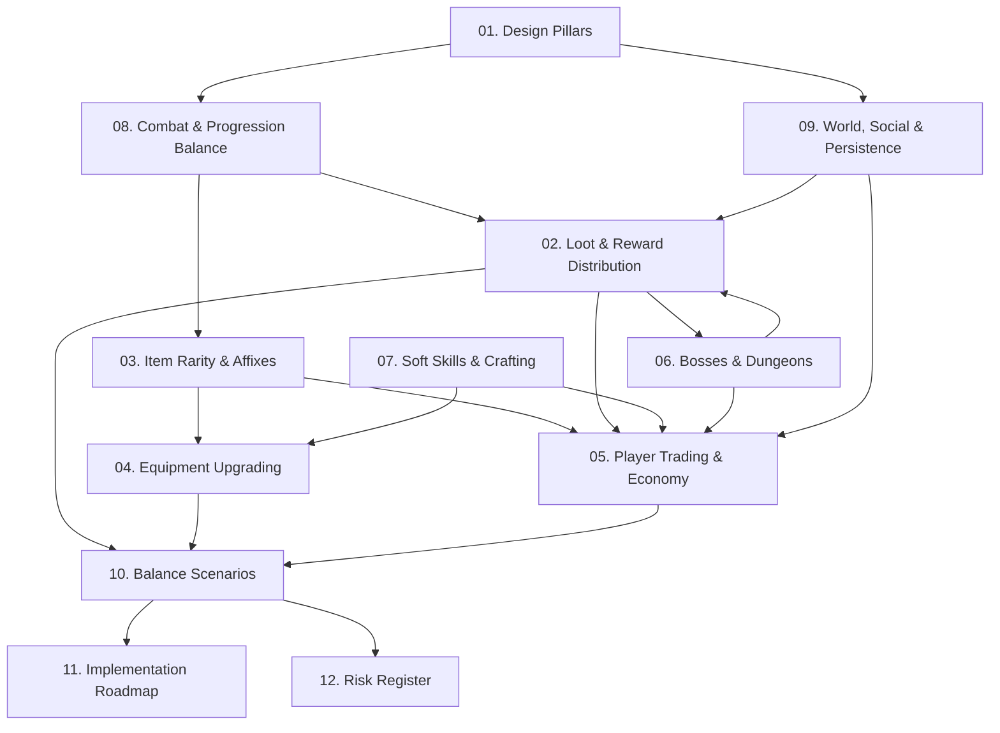

# Crusaders of Might and Magic Online — MMO Systems Design Specification

## 1. Project Overview & Scope

**Crusaders of Might and Magic Online** is a persistent browser-based MMORPG reimplementation inspired by 3DO's classic single-player action-RPG *Crusaders of Might and Magic* (1999). 

The client engine utilizes **Three.js** and WebGL for hardware-accelerated 3D rendering within modern web browsers. The authoritative backend runs on a **Node.js modular monolith** featuring a 20 Hz simulation tick rate, worker-thread zone partitions, Rapier3D physics/spatial sweeps, and PostgreSQL 18 (with Kysely ORM and row-level locking) for durable transactional persistence.

This documentation suite establishes the formal systems design required to transform single-player action mechanics into a secure, balanced, economically durable, and exploit-resistant multiplayer virtual world.

---

## 2. Core Design Principles

Every system in this specification adheres to five fundamental design tenets:

1. **Fairness & Contribution-Based Rewards:** Players must have equitable access to combat encounters, progression milestones, and rare loot without being marginalized by high-burst players, high-level griefers, or multiboxers.
2. **Server-Authoritative Anti-Exploit Security:** The client is never trusted for combat adjudication, loot assignment, trade execution, or item refinement. Systems are architected from the ground up to neutralize automated botting, AFK leeching, kill-stealing, and item duplication.
3. **Economic Equilibrium & Durability:** Every item and currency faucet is paired with a deliberate sink. Item inflation is strictly managed through upgrading risks, binding taxonomies, listing fees, and crafting consumption.
4. **Authenticity & Heritage Preservation:** The recognizable identity of the original game—its 11 damage types, attribute models, named items, grim gothic-fantasy art direction, and deliberate animation-timed combat—is retained and enhanced for cooperative multiplayer play.
5. **Architectural & Technical Feasibility:** All mechanics are designed for deterministic execution within the project's existing 20 Hz zone-worker loop, PostgreSQL row-level locking model, and Three.js client constraints.

---

## 3. Document Navigation & Index

The specification is organized into 12 modular, cross-referenced design volumes:

| Document | Primary Focus | Key Systems & Specifications |
|---|---|---|
| [01. MMO Design Pillars](01-mmo-design-pillars.md) | Architectural Vision | Core loops, SP vs. MMO divergence, social dynamics, non-goals. |
| [02. Loot & Reward Distribution](02-loot-and-reward-distribution.md) | Combat & Reward Lifecycle | Hybrid loot architecture, threat/damage contribution, anti-AFK thresholds, low-level scaling. |
| [03. Item Rarity & Affixes](03-item-rarity-and-affixes.md) | Equipment Generation | 4-tier rarity, cascading roll algorithms, affix pools, stat scaling, named item identities. |
| [04. Equipment Upgrading](04-equipment-upgrading.md) | Refinement & Visuals | +0 to +10 upgrade system, Failstack pity models, 3 material stages, Three.js glow shaders. |
| [05. Player Trading & Economy](05-player-trading-and-economy.md) | Commerce & Currency | Two-phase commit direct trade, centralized Auction House, binding rules, transaction atomicity. |
| [06. Bosses, Dungeons & Instances](06-bosses-dungeons-and-instances.md) | Group Content | Open-world world bosses, private dungeon instances, telegraphs, lockouts, disconnect handling. |
| [07. Soft Skills & Crafting](07-soft-skills-and-crafting.md) | Non-Combat Progression | Mining, Herbalism, Smithing, Alchemy, Salvaging; dynamic nodes, anti-bot interaction puzzles. |
| [08. Progression & Combat Balance](08-progression-and-combat-balance.md) | Mathematical Framework | Level 1–50 curve across existing maps, Sanctuary safe zones, damage pipeline, Item Power Score. |
| [09. World, Social & Persistence](09-world-social-and-persistence.md) | Infrastructure & Social | 20 Hz zone topology, spatial hashing, party/guild systems, PostgreSQL schema, disconnect recovery. |
| [10. Economy & Balance Scenarios](10-economy-and-balance-scenarios.md) | Quantitative Simulations | 8 stress scenarios: low-level kill stealing, multi-box farming, AH market saturation, +10 power leaps. |
| [11. Implementation Roadmap](11-implementation-roadmap.md) | Execution Plan | 6-stage engineering roadmap, dependency graphs, test suites, acceptance criteria for playable MVP. |
| [12. Open Decisions & Risk Register](12-open-decisions-and-risk-register.md) | Governance & Triage | Unresolved design trade-offs, high-risk technical assumptions, exploit mitigation ledger. |
| [13. Passive Skill Tree](13-passive-skill-tree.md) | Build Specialization | PoE-style 49-point tree, Minor/Notable/Keystones (Paid in Blood, Impenetrable Bastion). |

---

## 4. System Dependency Graph

The following Mermaid diagram maps the structural dependencies between all major game systems:

---

## 5. Status of Major Design Decisions

| System | Recommended Architectural Approach | Decision Status | Reference Section |
|---|---|---|---|
| **Loot Allocation** | Hybrid Individual Instanced Loot with Contribution Thresholds (5% damage or 10% support) | Recommended | [02. Loot Distribution §3](02-loot-and-reward-distribution.md#3-recommended-architecture-hybrid-individual-instanced-loot) |
| **Low-Level Contention** | Normalized Contribution Window with Encounter Scaling Caps | Recommended | [02. Loot Distribution §4](02-loot-and-reward-distribution.md#4-the-low-damage-contention-problem) |
| **Rarity Probabilities** | Cascading Cumulative Roll with Monster-Tier Multipliers | Recommended | [03. Item Rarity §2](03-item-rarity-and-affixes.md#2-rarity-probabilities--cascading-roll-mathematics) |
| **Named Items & Spawns** | Probabilistic Drop Rates on Bosses; Dynamic Rarity Roll on World Chests/Pickups | Adopted | [02. Loot §4](02-loot-and-reward-distribution.md#4-probabilistic-drops--fixed-world-pickups) / [03. Rarity §3](03-item-rarity-and-affixes.md#3-named-items--fixed-map-spawns) |
| **Refinement System** | Cap +10, Zero Destruction, Zero Regression, Cumulative Failstack Pity (3 Material Stages) | Adopted | [04. Equipment Upgrading §2](04-equipment-upgrading.md#2-upgrade-progression--material-taxonomy-0-to-10) |
| **Trading Architecture** | Two-Phase Commit with Row-Level DB Locking (`FOR UPDATE`) | Recommended | [05. Trading & Economy §2](05-player-trading-and-economy.md#2-direct-player-to-player-trading) |
| **Auction House** | Asynchronous Escrow with 5% Listing Fee Sink & 10% Sale Tax | Recommended | [05. Trading & Economy §3](05-player-trading-and-economy.md#3-centralized-auction-house-specification) |
| **Dungeon Topology** | Party-Leased Dedicated Zone Workers with Auto-Teardown | Recommended | [06. Bosses & Dungeons §2](06-bosses-dungeons-and-instances.md#2-instance-topology--worker-allocation) |
| **Soft Skills Economy** | Independent Secondary Skill Trees (1–100) as Upgrading Material Faucets | Recommended | [07. Soft Skills §2](07-soft-skills-and-crafting.md#2-selected-skill-taxonomy) |
| **Database Transactions** | Optimistic In-Memory Simulation + Write-Ahead Logging / Pessimistic DB Sync | Recommended | [09. Persistence §3](09-world-social-and-persistence.md#3-persistence-engine--transactional-atomicity) |

---

## 6. Recommended Reading Order

For systems engineers, backend developers, and design evaluators, the recommended reading sequence is:

1. **Foundations:** Read [01. MMO Design Pillars](01-mmo-design-pillars.md) to understand scope, target audience, and non-negotiable boundaries.
2. **Combat & Equipment Core:** Read [08. Progression & Combat Balance](08-progression-and-combat-balance.md), [02. Loot Distribution](02-loot-and-reward-distribution.md), [03. Item Rarity & Affixes](03-item-rarity-and-affixes.md), and [04. Equipment Upgrading](04-equipment-upgrading.md).
3. **Multiplayer Dynamics & Economy:** Read [05. Player Trading & Economy](05-player-trading-and-economy.md), [06. Bosses, Dungeons & Instances](06-bosses-dungeons-and-instances.md), and [07. Soft Skills & Crafting](07-soft-skills-and-crafting.md).
4. **Systems Architecture & Security:** Read [09. World, Social & Persistence](09-world-social-and-persistence.md).
5. **Validation & Delivery:** Review [10. Economy & Balance Scenarios](10-economy-and-balance-scenarios.md), [11. Implementation Roadmap](11-implementation-roadmap.md), and [12. Open Decisions & Risk Register](12-open-decisions-and-risk-register.md).
